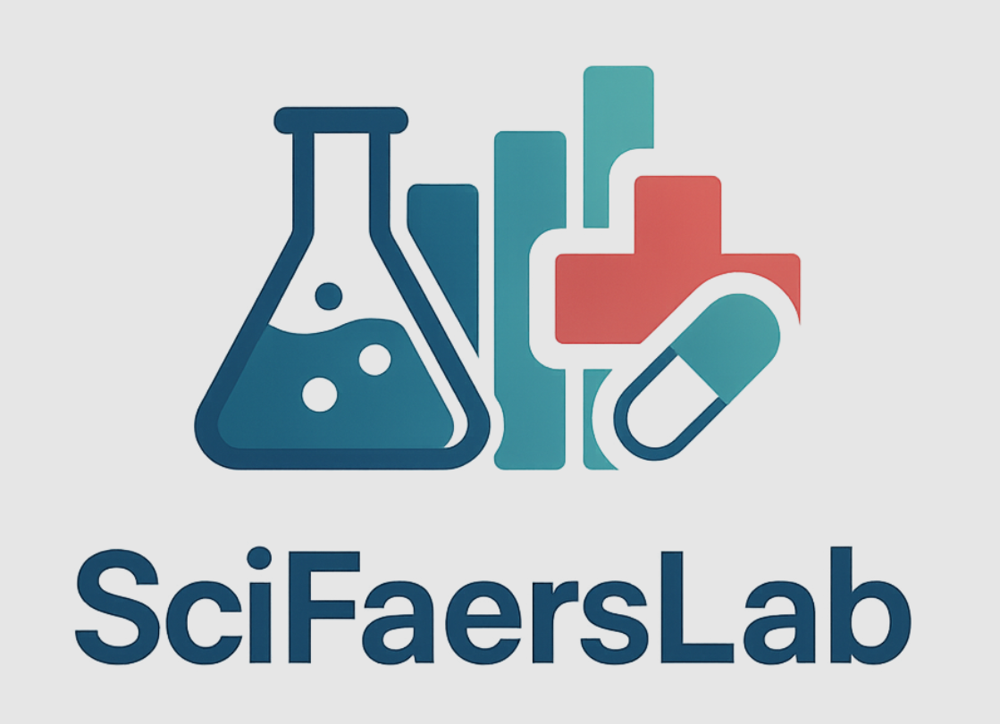

# SciFaersLab

**把药物警戒数据挖掘、统计分析和论文绘图放进一个零代码工作流。覆盖90%FAERS数据挖掘论文套路**

面向医学、药学研究生、医生及科研人员。无需配置 R、Python、SQL，  
解压整合包即可完成从数据整理、信号检测到论文级图表输出的完整流程。

> Windows 10 / 11 · 零代码 · 季度数据库整合包 · 邮箱更新

国内访问：[Gitee 主站](https://gitee.com/Twilight-of-sea/sci-faers-lab) · 备用镜像：[GitHub](https://github.com/TwilightOfSea/Sci-Faers-Lab-Clone)

## 快速入口

| 我想 | 从这里开始 |
|---|---|
| 看软件实际运行 | [完整流程演示](https://www.bilibili.com/video/BV1AHeozNEXt/) |
| 查找全部功能 | [查看功能模块详解](./功能模块详解.md) |
| 免费体验论文绘图 | [下载绘图工具 v3.0](./绘图工具+部分脚本/绘图工具v3.0下载链接.md) |
| 了解完整分析服务 | [查看功能、服务与价格](#服务与价格) |
| 学习具体操作 | [查看软件操作说明书](./软件操作说明.md) |
| 设计研究方案 | [查看文章套路](./文章套路.md)  |
| 选题找方向 | [查看选题信息](./选题信息.md) / [公众号文献导读](https://mp.weixin.qq.com/mp/appmsgalbum?__biz=Mzk5MDU3NjYxOQ==&action=getalbum&album_id=3998224450897313809#wechat_redirect)|

## 它解决什么问题

- **数据准备**：内置整理后的季度数据库，省去下载，信号检测工具内自动完成清洗、合并和去重步骤。
- **信号分析**：完成基线统计、信号检测、亚组分析、逻辑回归和机器学习分析。
- **论文绘图**：用图形化绘图工具输出可直接用于论文的图表和统计表。
- **智能答疑**：内置 SciFaersLab 聊天助手，可咨询数据库范围、分析方法和软件操作；AI 回答由大模型生成，使用时请结合原始数据与文献进行甄别。
- **持续更新**：数据库、分析模块和绘图脚本随版本更新，通过邮箱发送整合包。

## 核心能力

| 模块 | 主要能力 | 说明 |
|---|---|---|
| 信号监测 | ROR、PRR、MGPS、BCPNN 等常用信号检测算法 | [操作说明](./软件操作说明.md#一不良数据库信号监测系统) |
| 亚组分析 | 年龄、性别、时间、上报者、联合用药及自定义条件分组 | [操作说明](./软件操作说明.md#三亚组分析工具大数据) |
| 统计分析 | 基线数据、描述统计、多因素 Logistic 回归、机器学习、共病分析 | [功能目录](./功能模块详解.md) |
| 拓展模块 | JADER、CVARD、DDI、网络药理学和敏感性分析 | [功能目录](./功能模块详解.md) |
| 论文绘图 | 常用 PT、SOC、森林图、火山图、韦伯分布等论文级图表 | [绘图教程](./软件操作说明.md#五画图工具) |
| 选题信息 | 9K种药物历史发表情况、FAERS 文献信息和选题方法 | [选题信息](./选题信息.md) |
| AI 聊天助手 | 数据挖掘方法、软件操作与学术写作咨询；支持多模型对话 | [操作说明](./软件操作说明.md#小工具数据库挖掘ai小助手) |

当前版本：**v1.60-26Q3**（2026-11-01发布）  
[查看版本更新记录](./更新日志/v1.60版本更新日志.md)

## 免费与完整版

| 免费部分 | 完整付费服务 |
|---|---|
| 图形化绘图工具 | 完整数据分析系统 |
| 部分示例绘图脚本 | 全套绘图脚本与后续更新 |
| 图像模板和使用文档 | 季度数据库整合包 |
| 文章套路与数据库说明 | JADER、CVARD、DDI、网络药理学等拓展模块 |
| 基础操作视频 | 功能更新、脚本更新和选题信息推送 |

免费绘图部分采用仓库 [LICENSE](./LICENSE) 所列许可。  
付费分析系统按设备授权，具体使用与更新范围以购买时的服务说明为准。

## 服务与价格

| 服务期 | 价格 | 包含内容 |
|---|---:|---|
| 半年 | 800 元 | 服务期内完整分析功能、全套脚本、数据库与版本更新 |
| 一年 | 1,200 元 | 同上，服务期一年 |
| 永久版 | 按需求单独报价 | 根据功能范围、设备和使用需求确认 |

数据库更新后，会通过邮箱发送最新整合包，无需手动下载各季度原始文件。

## 使用前确认

| 项目 | 要求 |
|---|---|
| 操作系统 | Windows 10 / 11 |
| 内存 | 建议 8 GB 以上 |
| 存储空间 | 至少 5 GB 可用空间 |
| 数据交付 | 通过邮箱发送整合包 |
| 授权方式 | 分析模块与设备绑定，更换设备请提前联系 |
| 服务范围 | 软件使用指导与故障排查 |

## 常见问题

**没有编程基础可以使用吗？**  
可以。数据和图表均通过图形界面完成，不需要写代码。

**免费版和完整版有什么区别？**  
免费版提供绘图工具、部分脚本和学习资料；完整版包含分析系统、全套脚本、季度数据整合包和持续更新。

**数据库范围和方法部分应该怎么描述？**  
 [数据库范围和方法说明](./数据库范围和方法说明.md)

**数据库多久更新一次？**  
随FDA官方数据版本更新，通过邮箱推送新的整合包。
[日本JADER](./拓展模块/Jader数据库挖掘工具.md)和[加拿大CVARD](./拓展模块/CVARD加拿大数据库挖掘工具.md)随版本更新，也可以直接从对应官网下载，根据教程导入。

**支持 macOS 吗？**  
目前仅支持 Windows 10 / 11。

**购买后提供论文指导吗？**  
服务以软件使用指导和故障排查为主，不提供论文代写。

## 数据说明

本项目用于药物警戒研究、数据探索和科研分析。FAERS 等自发报告数据库
适合发现风险信号和生成研究假设，不能直接计算不良反应发生率，
也不能单独证明药物与不良事件之间存在因果关系。

研究成果应结合研究设计、临床背景和其他数据来源综合判断。

## 开始使用

1. 观看[完整流程演示](https://www.bilibili.com/video/BV1AHeozNEXt/)，确认是否符合你的研究需求。
2. 免费体验[绘图工具 v3.0](./绘图工具+部分脚本/绘图工具v3.0下载链接.md) 或阅读[操作说明](./软件操作说明.md)。
3. 如需完整分析系统，添加微信并备注来意。

---

README 最后更新：2026-11-14
