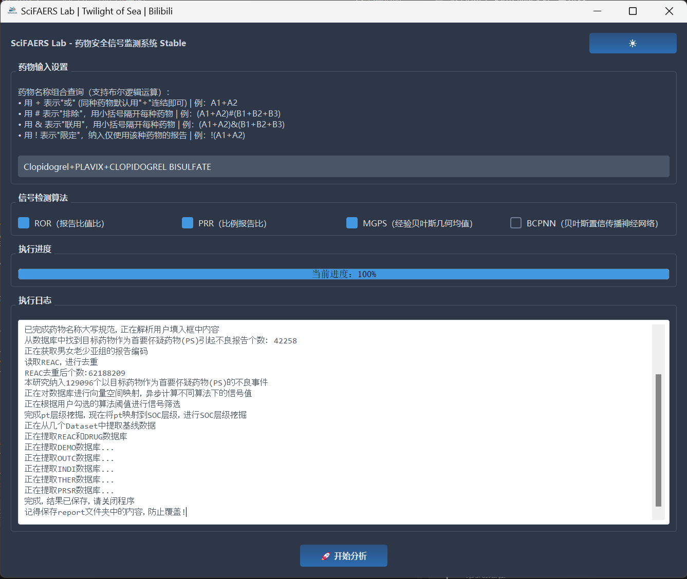
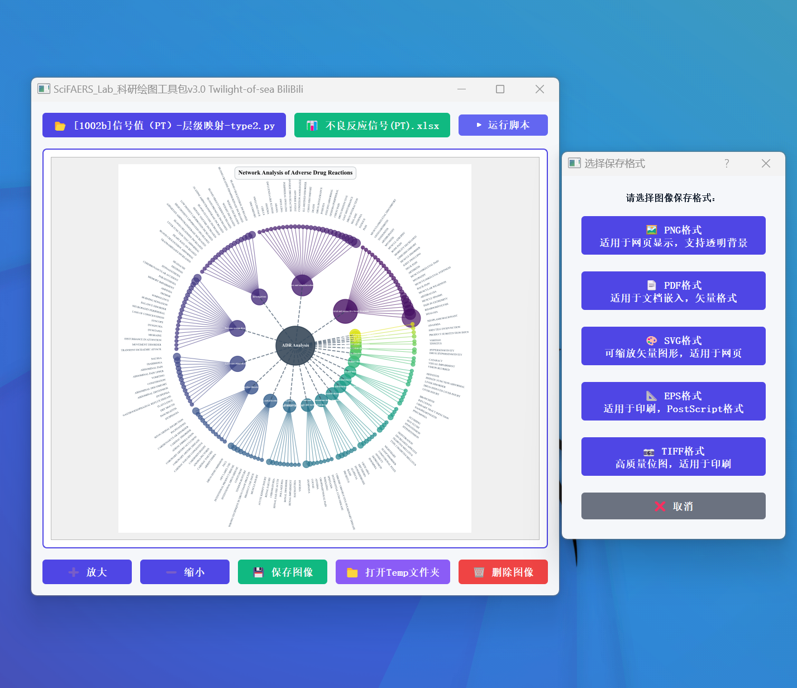
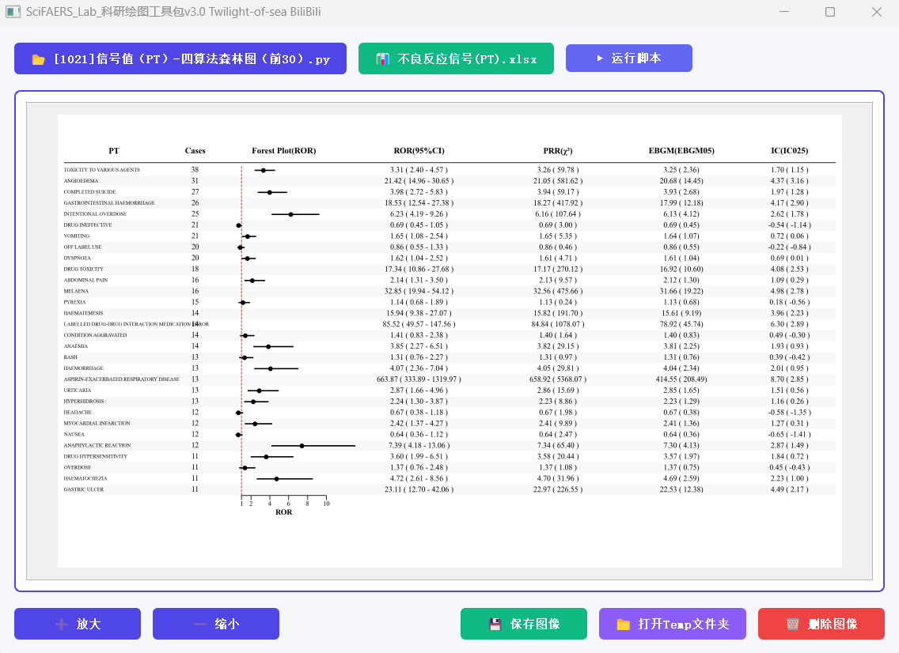
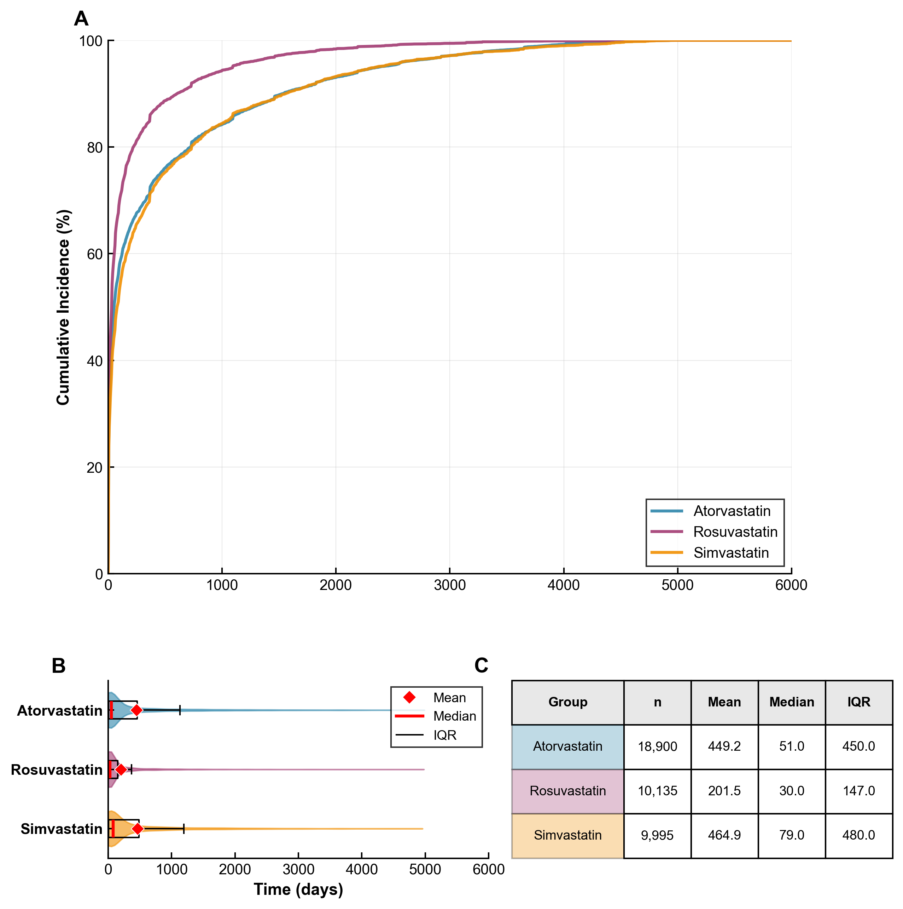
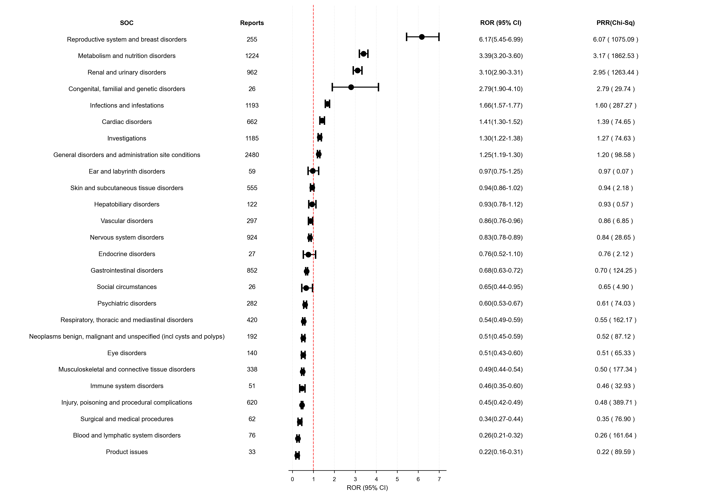
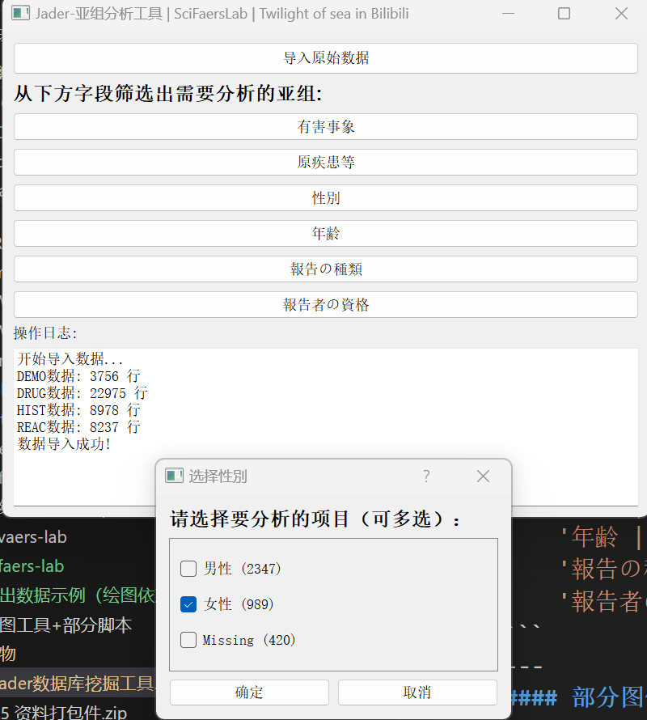
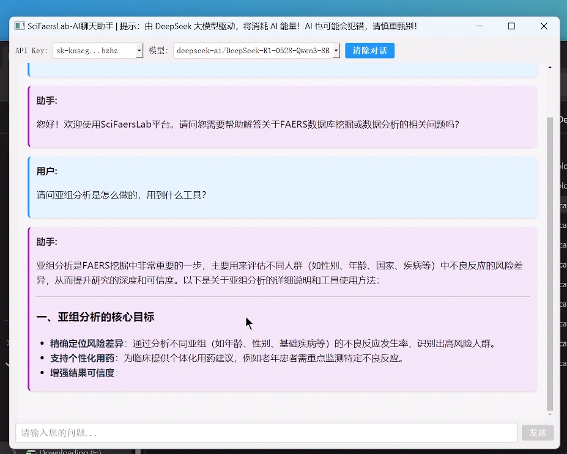
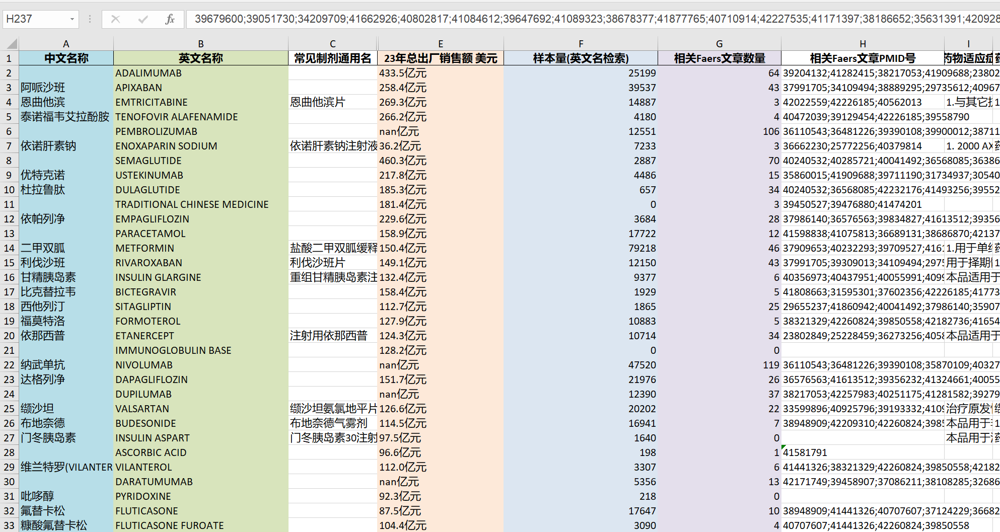
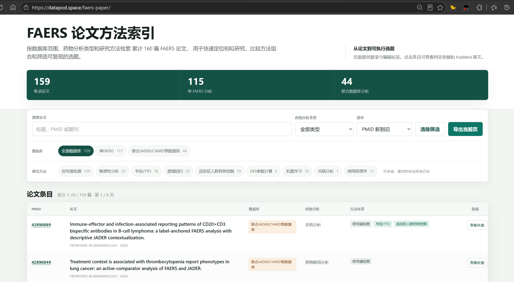
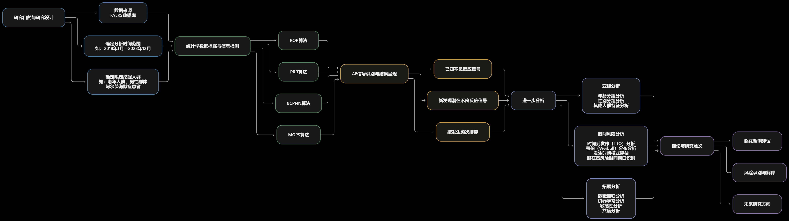

<h1>SciFaersLab</h1>

**FAERS 数据挖掘、统计分析和论文绘图，一条零代码工作流。**

面向医学、药学研究生、临床医生和科研人员。数据清洗、信号检测、亚组分析、统计建模和论文图表都在图形界面中完成，无需配置 R、Python 或 SQL。

国内用户推荐访问：[**Gitee 主站**](https://gitee.com/Twilight-of-sea/sci-faers-lab) · [GitHub 备用镜像](https://github.com/TwilightOfSea/Sci-Faers-Lab-Clone)

[快速入口](#快速入口) · [核心能力](#核心能力) · [论文图表](#论文图表) · [研究资源](#研究资源) · [版本与服务](#版本与服务) · [常见问题](#常见问题)

输入目标药物，选择检测算法，平台自动完成数据库读取、去重、信号计算和结果保存。

## 快速入口

| 你的下一步 | 直接进入 |
|---|---|
| 从零开始学习 FAERS 数据挖掘 | [B 站：从零开始教学](https://www.bilibili.com/video/BV1uifhYdEQn/) |
| 看平台实际运行 | [B 站：平台旗舰演示](https://www.bilibili.com/video/BV1AHeozNEXt/) |
| 查找全部功能 | [功能模块详解](./功能模块详解.md) |
| 学习具体操作 | [软件操作说明](./软件操作说明.md) |
| 设计研究方案 | [文章套路](./文章套路.md) |
| 参看选题信息 | [选题信息](./选题信息.md) |
| 核对数据范围与方法 | [数据库范围和方法说明](./数据库范围和方法说明.md) |

**补充资源：** [免费绘图工具 v3.0](./绘图工具+部分脚本/绘图工具v3.0下载链接.md) · [FAERS 论文方法索引](https://datapod.space/faers-paper/) · [查看版本更新](./更新日志/v1.60版本更新日志.md)

## 一个平台，完成从数据到论文

<table>
<tr>
<td align="center" width="25%"><b>01 数据准备</b>  内置季度数据库 自动合并、去重和标准化</td>
<td align="center" width="25%"><b>02 信号检测</b>  ROR、PRR、MGPS、BCPNN 同时完成基线统计</td>
<td align="center" width="25%"><b>03 深入分析</b>  亚组、回归、机器学习 TTO、韦伯分布、共病分析</td>
<td align="center" width="25%"><b>04 论文输出</b>  统计分析表与 SCI 级图表 可直接导出和继续编辑</td>
</tr>
</table>

## 核心能力

| 模块 | 你能完成什么 |
|---|---|
| **信号监测** | 按药物名称、商品名或组合条件检索，完成数据库清洗、去重、PT/SOC 映射和常用信号检测，导出统计表与原始结果。 |
| **亚组分析** | 按年龄、性别、国家、上报者、联合用药或自定义条件分组；支持已有数据精细拆分，也支持大数据人群库构建。 |
| **统计与预测** | 基线数据、描述统计、多因素 Logistic 回归、机器学习、共病分析、敏感性分析、诱发时间与累积发生率分析。 |
| **论文绘图** | 160+ 图形模板，覆盖森林图、火山图、小提琴图、韦伯分布、共病网络等；支持 PNG、PDF、SVG、EPS、TIFF 导出。 |
| **其他数据库** | [JADER](./拓展模块/Jader数据库挖掘工具.md)、[CVARD](./拓展模块/CVARD加拿大数据库挖掘工具.md) 插件，以及 [DDI 药物相互作用](./拓展模块/DDI药物相互作用计算说明文档.md)、[网络药理学](./拓展模块/网络药理学拓展模块.md)和多药信号交联模块。 |
| **选题与答疑** | 9000 种药物历史发表情况、FAERS 论文方法索引，以及内置平台提示词的 AI 聊天助手。 |

## 论文绘图

选择脚本、载入结果表、点击运行，即可在平台内预览并保存图像。绘图工具也可以脱离完整分析系统单独使用。

图形界面中完成脚本选择、图像预览和 PNG / PDF / SVG / EPS / TIFF 导出。

## 论文图表

<table>
<tr>
<td align="center" width="50%">
 
多算法联合森林图
</td>
<td align="center" width="50%">
 
累积发生率、诱发时间与统计表
</td>
</tr>
<tr>
<td align="center" width="50%">
 
SOC 层级信号森林图
</td>
<td align="center" width="50%">
 
JADER 亚组分析模块
</td>
</tr>
</table>

## AI 与研究辅助

平台内置的 AI 助手带有 FAERS 数据分析和 SciFaersLab 操作提示词，适合用来梳理方法、核对操作步骤和启发研究设计。AI 回答由大模型生成，仍需结合原始数据、软件文档和文献判断。

## 研究资源

从选题、研究结构到实际分析，配套资料与软件使用同一套术语，减少在论文、教程和操作界面之间来回切换。

<table>
<tr>
<td align="center" width="50%">
 
药物历史发表情况，用于判断选题空间
</td>
<td align="center" width="50%">
 
按数据库、分析类型和研究方法筛选论文
</td>
</tr>
</table>

从研究目的、数据来源、信号检测到亚组和诱发时间分析，可按流程图组织研究。

完整的研究框架、图表组合和常见套路见 [文章套路](./文章套路.md)；数据库覆盖范围、清洗逻辑和 Method 写法见 [数据库范围和方法说明](./数据库范围和方法说明.md)。

## 免费版与完整版

| 类型 | 提供内容 |
|:--|:--|
| **免费版** | 绘图工具、部分绘图脚本、示例数据和学习教程 |
| **完整版** | 完整分析系统、季度数据库整合包、全套绘图脚本、拓展模块和选题信息更新 |

免费绘图部分按仓库 [LICENSE](./LICENSE) 所列许可使用。付费分析系统按设备授权，具体功能与更新范围以购买时的服务说明为准。

## 版本与服务

当前版本：**v1.60-26Q3**（2026-11-01 发布），数据库覆盖 **2004Q1-2026Q3，共 91 个季度**。

| 服务期 | 价格 | 包含内容 |
|:--|--:|:--|
| 半年 | 800 元 | 服务期内完整分析功能、全套脚本、数据库与版本更新 |
| 一年 | 1,200 元 | 同上，服务期一年 |
| 永久版 | 按需求单独报价 | 根据功能范围、设备和使用需求确认 |

数据库更新后通过邮箱发送最新整合包，无需逐季下载原始文件。JADER 和 CVARD 也可直接使用官网数据，按对应教程导入。

<b>运行环境与交付方式</b>

| 项目 | 要求 |
|---|---|
| 操作系统 | Windows 10 / 11 |
| 内存 | 建议 8 GB 以上 |
| 存储空间 | 至少 5 GB 可用空间 |
| 数据交付 | 通过邮箱发送整合包 |
| 授权方式 | 分析模块与设备绑定，更换设备请提前联系 |
| 服务范围 | 软件使用指导与故障排查 |

## 常见问题

<b>没有编程基础可以使用吗？</b>

可以。数据导入、信号检测、统计分析和绘图都通过图形界面完成，不需要编写代码。

<b>免费版和完整版有什么区别？</b>

免费版提供绘图工具、部分脚本和学习资料；完整版包含分析系统、全套脚本、季度数据整合包和持续更新。

<b>数据库多久更新一次？</b>

随 FDA 官方数据版本更新，通过邮箱推送新的整合包。日本 JADER 和加拿大 CVARD 模块随版本更新，也可以按教程导入官网数据。

<b>购买后提供论文写作或代写服务吗？</b>

服务以软件使用指导和故障排查为主，不提供论文代写。研究方案可参考 [文章套路](./文章套路.md)。

> **数据说明：** FAERS 等自发报告数据库适合发现风险信号和生成研究假设，不能直接计算不良反应发生率，也不能单独证明药物与不良事件之间存在因果关系。研究结论应结合研究设计、临床背景和其他数据来源综合判断。

## 开始使用

1. 观看 [平台旗舰演示](https://www.bilibili.com/video/BV1AHeozNEXt/)，确认工作流是否符合你的研究需求。
2. 免费体验 [绘图工具 v3.0](./绘图工具+部分脚本/绘图工具v3.0下载链接.md)，或先阅读 [软件操作说明](./软件操作说明.md)。
3. 如需完整分析系统，添加微信并备注来意。

---

国内访问：[Gitee 主站](https://gitee.com/Twilight-of-sea/sci-faers-lab) · 备用镜像：[GitHub](https://github.com/TwilightOfSea/Sci-Faers-Lab-Clone) · 视频教程：[平台旗舰演示](https://www.bilibili.com/video/BV1AHeozNEXt/)

[English README](README_en.md) · README 最后更新：2026-11-23

