

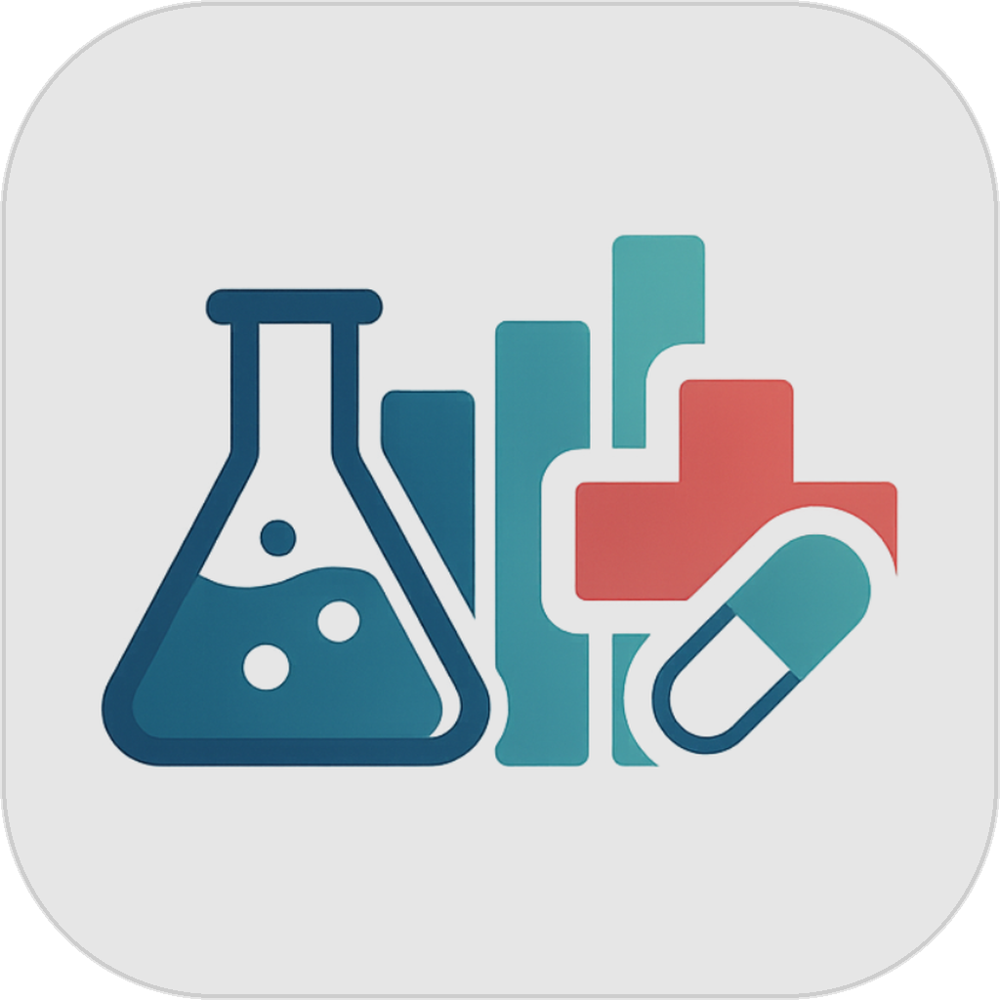

<h1>SciFaersLab</h1>

**FAERS mining, statistical analysis, and publication-ready figures in one no-code workflow.**

Built for medical and pharmacy researchers, clinicians, and research teams. Clean data, detect safety signals, run subgroup analysis, build statistical models, and produce manuscript figures through a graphical interface, with no R, Python, or SQL setup.

[Quick Start](#quick-start) · [Core Capabilities](#core-capabilities) · [Figures](#paper-figures) · [Research Resources](#research-resources) · [Versions and Service](#versions-and-service) · [FAQ](#faq)

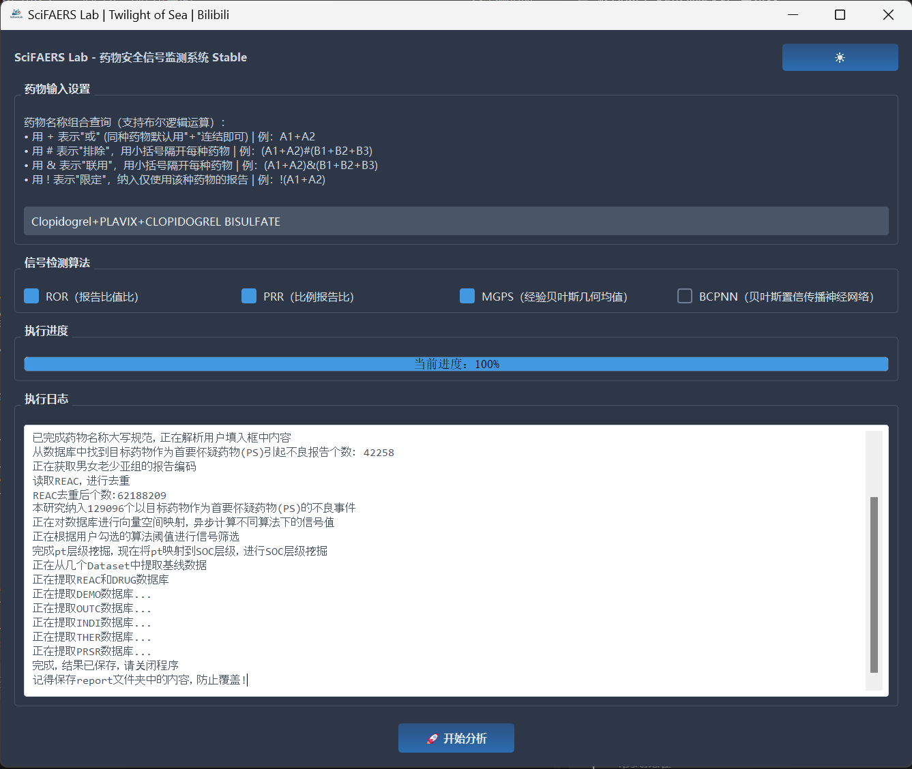

Enter a target drug, select algorithms, and let the platform handle database loading, deduplication, signal calculation, and result export.

## Quick Start

| What you need | Start here |
|---|---|
| Learn FAERS analysis from scratch | [Bilibili course: FAERS for beginners](https://www.bilibili.com/video/BV1uifhYdEQn/) |
| Watch the platform in action | [Bilibili: full platform walkthrough](https://www.bilibili.com/video/BV1AHeozNEXt/) |
| Browse every feature | [Feature catalog](./功能模块详解.md) |
| Follow step-by-step instructions | [Software guide](./软件操作说明.md) |
| Design a study | [Research playbook](./文章套路.md) |
| Look for a research topic | [Topic information](./选题信息.md) |
| Check data coverage and methods | [Database scope and methods](./数据库范围和方法说明.md) |

**More resources:** [Free plotting tool v3.0](./绘图工具+部分脚本/绘图工具v3.0下载链接.md) · [FAERS paper method index](https://datapod.space/faers-paper/) · [Latest release notes](./更新日志/v1.60版本更新日志.md)

> The linked product documentation and video courses are currently provided in Chinese.

## From Data to Manuscript

<table>
<tr>
<td align="center" width="25%"><b>01 Prepare data</b>  Quarterly databases included Automatic merge, deduplication, and standardization</td>
<td align="center" width="25%"><b>02 Detect signals</b>  ROR, PRR, MGPS, and BCPNN Baseline statistics included</td>
<td align="center" width="25%"><b>03 Analyze further</b>  Subgroups, regression, and ML TTO, Weibull, and comorbidity analysis</td>
<td align="center" width="25%"><b>04 Produce outputs</b>  Statistical tables and publication figures Ready to export and refine</td>
</tr>
</table>

## Core Capabilities

| Module | What you can do |
|---|---|
| **Signal detection** | Search by generic name, brand name, or compound conditions; clean and deduplicate records, map PT/SOC terms, run common signal algorithms, and export statistics and source results. |
| **Subgroup analysis** | Compare age, sex, country, reporter, comedication, or custom groups; refine an existing dataset or build focused population databases from large data. |
| **Statistics and prediction** | Baseline tables, descriptive statistics, multivariable logistic regression, machine learning, comorbidity analysis, sensitivity analysis, time-to-onset, and cumulative incidence. |
| **Publication figures** | More than 160 templates for forest plots, volcano plots, violin plots, Weibull curves, comorbidity networks, and more; export to PNG, PDF, SVG, EPS, or TIFF. |
| **Additional databases** | [JADER](./拓展模块/Jader数据库挖掘工具.md) and [CVARD](./拓展模块/CVARD加拿大数据库挖掘工具.md) plug-ins, plus [DDI drug interaction analysis](./拓展模块/DDI药物相互作用计算说明文档.md), [network pharmacology](./拓展模块/网络药理学拓展模块.md), and multi-drug signal networks. |
| **Topics and AI support** | Historical publication information for 9,000 drugs, a FAERS paper method index, and an AI assistant with platform-specific prompts. |

## Paper-Ready Plotting

Choose a script, load the result table, and run it. Preview and export the figure directly from the plotting tool, which can also be used without the full analysis system.

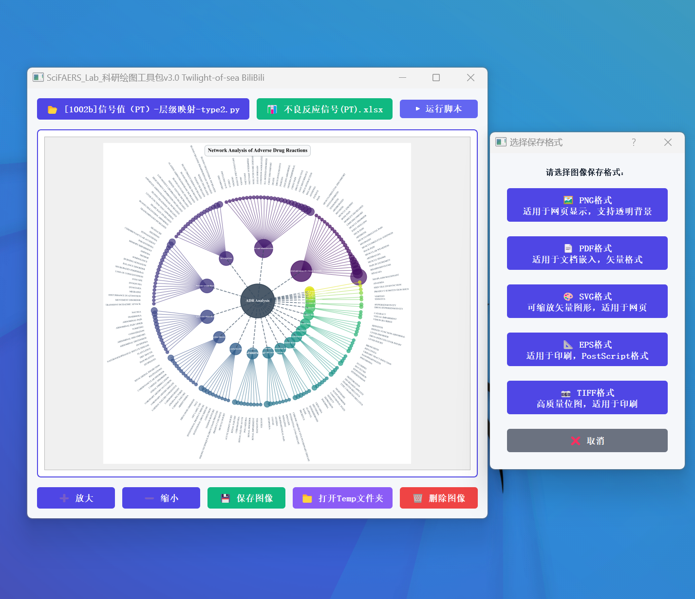

Select scripts, preview figures, and export as PNG, PDF, SVG, EPS, or TIFF in one graphical tool.

## Paper Figures

<table>
<tr>
<td align="left" width="50%">
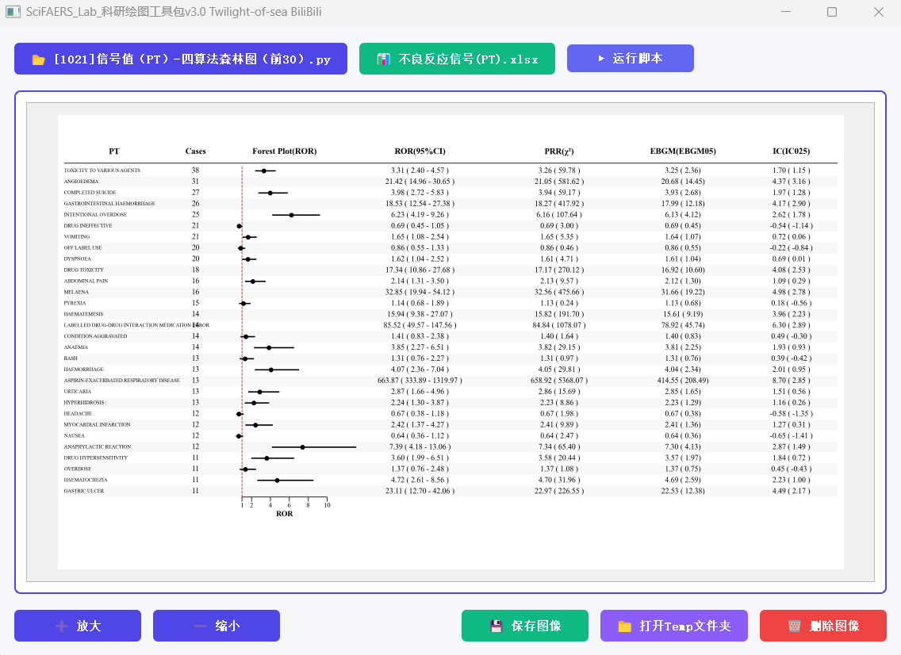 
Multi-algorithm forest plot
</td>
<td align="left" width="50%">
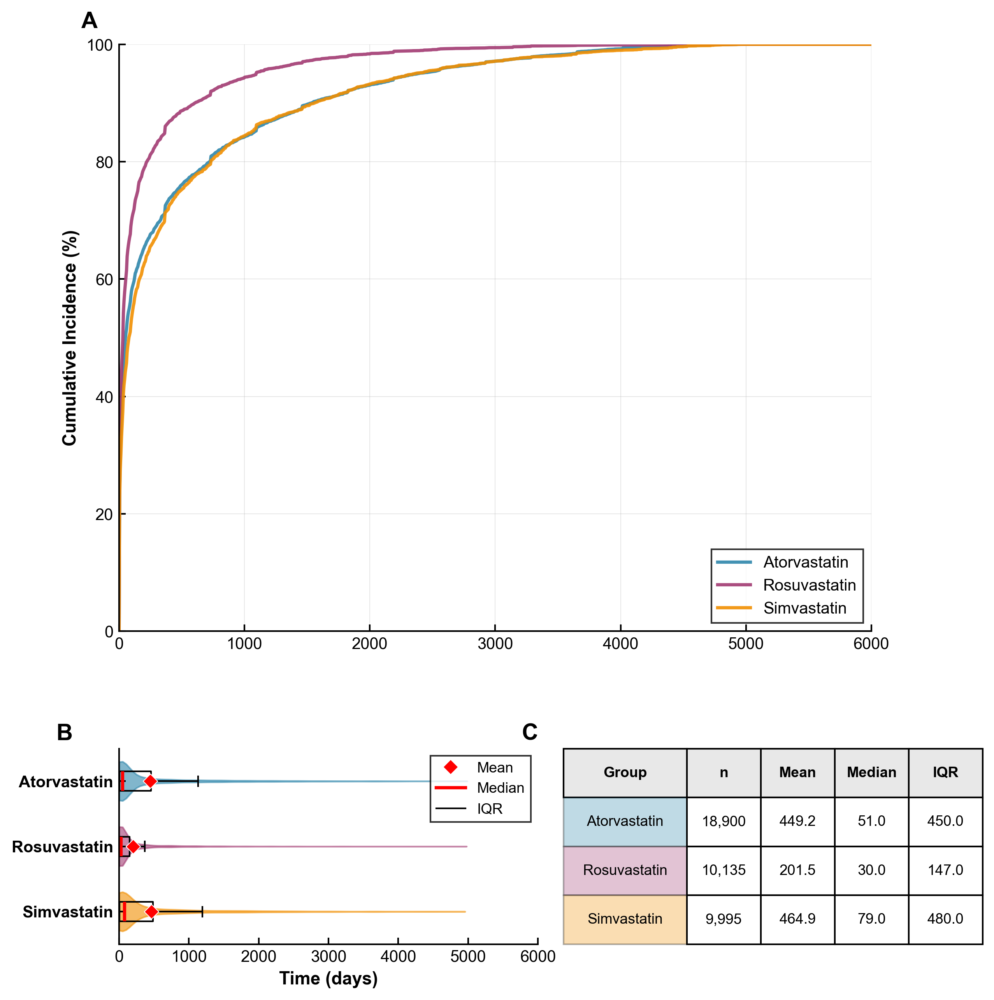 
Cumulative incidence, TTO, and summary table
</td>
</tr>
<tr>
<td align="left" width="50%">
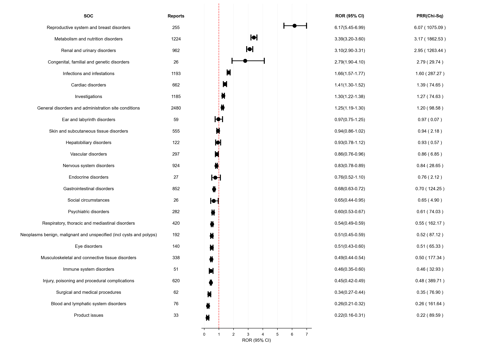 
SOC-level signal forest plot
</td>
<td align="left" width="50%">
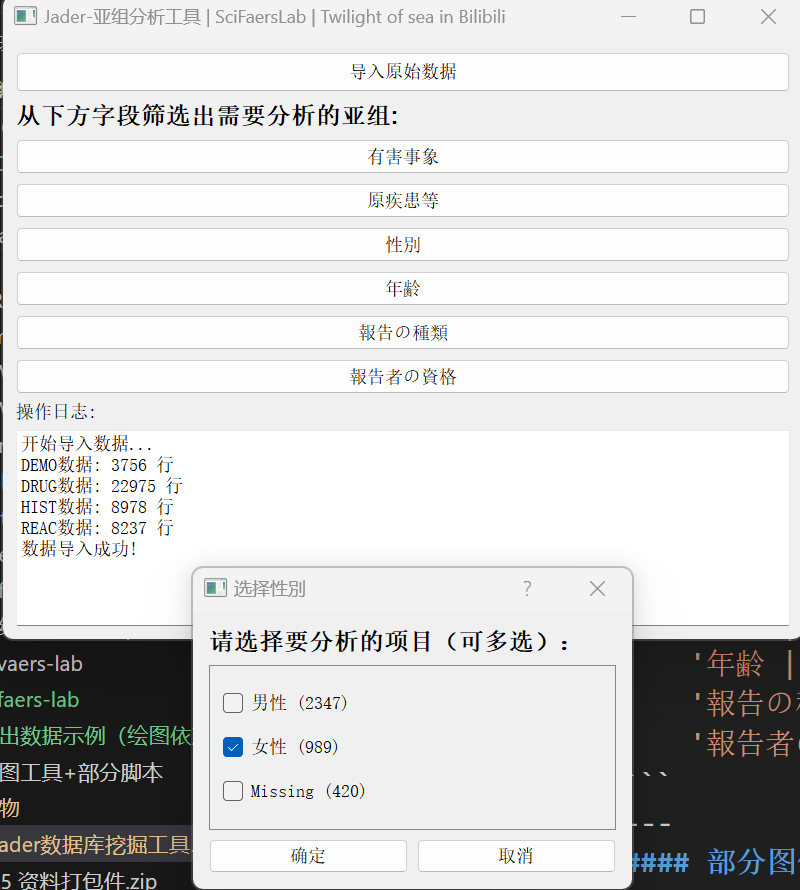 
JADER subgroup module
</td>
</tr>
</table>

## AI and Research Support

The built-in assistant carries FAERS analysis and SciFaersLab operating prompts. It is useful for organizing methods, checking workflows, and exploring study designs. AI output is generated by a language model and should always be checked against the source data, documentation, and literature.

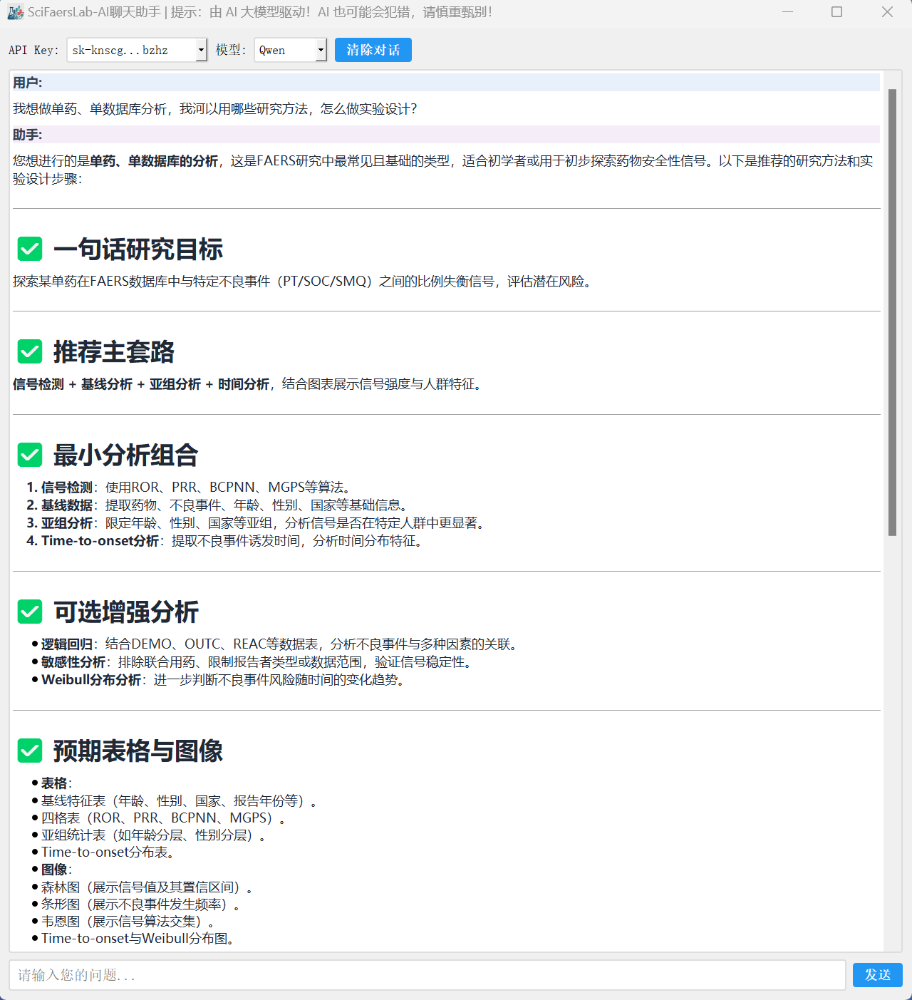

## Research Resources

Topic discovery, study structure, and hands-on analysis use a consistent set of terms, so you spend less time reconciling tutorials, papers, and software screens.

<table>
<tr>
<td align="left" width="50%">
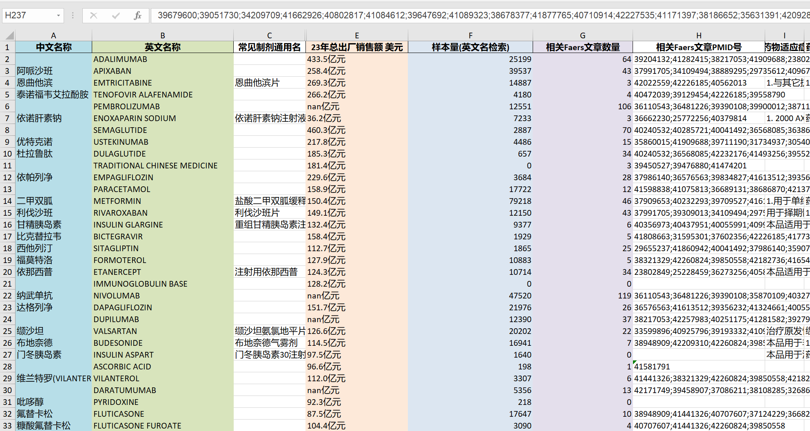 
Drug publication history for topic screening
</td>
<td align="left" width="50%">
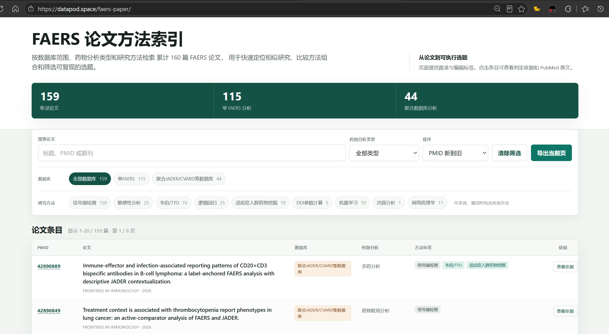 
Filter papers by database, analysis type, and method
</td>
</tr>
</table>

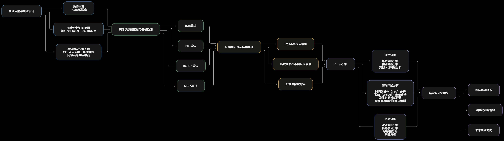

Organize a study around the objective, data source, signal detection, subgroup analysis, time-to-onset, and conclusions.

See [Research playbook](./文章套路.md) for study frameworks and figure combinations, and [Database scope and methods](./数据库范围和方法说明.md) for coverage, cleaning logic, and method-writing examples.

## Free and Full Versions

| Edition | What is included |
|:--|:--|
| **Free** | Plotting tool, selected plotting scripts, sample data, and tutorials |
| **Full** | Complete analysis system, quarterly database package, full plotting scripts, extension modules, and topic updates |

The free plotting resources follow the repository [LICENSE](./LICENSE). The paid analysis system is licensed per device; the exact feature and update scope is confirmed at purchase.

## Versions and Service

Current version: **v1.60-26Q3** (released 2026-11-01). The database covers **2004Q1-2026Q3, 91 quarters**.

| Service period | Price | Included |
|:--|--:|:--|
| Six months | CNY 800 | Full analysis features, complete scripts, database, and updates during the service period |
| One year | CNY 1,200 | The same scope for one year |
| Perpetual | Quoted per request | Confirmed by feature scope, devices, and usage requirements |

Updated database packages are delivered by email, so there is no need to download each quarterly source file manually. JADER and CVARD can also use official source data imported through the provided guides.

<b>System requirements and delivery</b>

| Item | Requirement |
|---|---|
| Operating system | Windows 10 / 11 |
| Memory | 8 GB or more recommended |
| Storage | At least 5 GB available |
| Data delivery | Integrated package sent by email |
| Licensing | Analysis modules are bound to the device; contact us before changing devices |
| Support | Software usage guidance and troubleshooting |

## FAQ

<b>Can I use it without programming experience?</b>

Yes. Data import, signal detection, statistical analysis, and plotting are performed through graphical interfaces without writing code.

<b>What is the difference between the free and full versions?</b>

The free version provides the plotting tool, selected scripts, and learning materials. The full version adds the analysis system, complete scripts, quarterly database packages, and ongoing updates.

<b>How often is the database updated?</b>

Updates follow the official FDA data releases and are sent by email as new packages. The JADER and CVARD modules are updated with the product, and official source data can also be imported through the guides.

<b>Is paper writing or ghostwriting included?</b>

Support covers software usage and troubleshooting, not paper ghostwriting. For study design guidance, see the [Research playbook](./文章套路.md).

> **Data note:** Spontaneous reporting databases such as FAERS are suitable for detecting risk signals and generating research hypotheses. They cannot directly estimate adverse-event incidence or prove causality on their own. Conclusions should be interpreted together with the study design, clinical context, and other data sources.

## Get Started

1. Watch the [full platform walkthrough](https://www.bilibili.com/video/BV1AHeozNEXt/) to see whether the workflow fits your research.
2. Try the [free plotting tool v3.0](./绘图工具+部分脚本/绘图工具v3.0下载链接.md), or read the [software guide](./软件操作说明.md).
3. For the full analysis system, add us on WeChat and mention SciFaersLab.

---

China access: [Gitee](https://gitee.com/Twilight-of-sea/sci-faers-lab) · Mirror: [GitHub](https://github.com/TwilightOfSea/Sci-Faers-Lab-Clone) · Video: [Full platform walkthrough](https://www.bilibili.com/video/BV1AHeozNEXt/)

[简体中文 README](README.md) · Last updated: 2026-11-23

