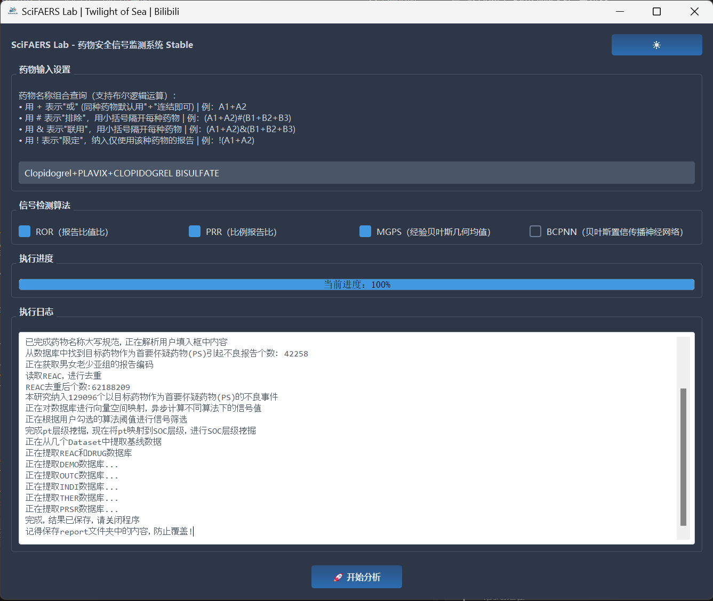
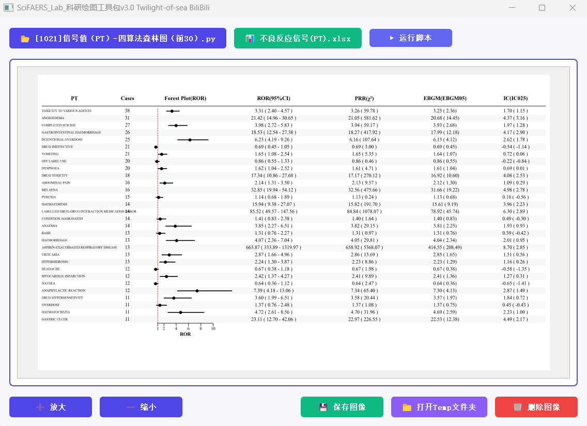
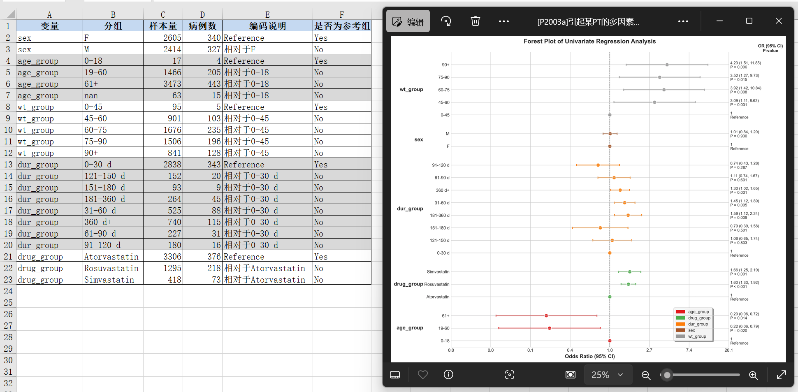
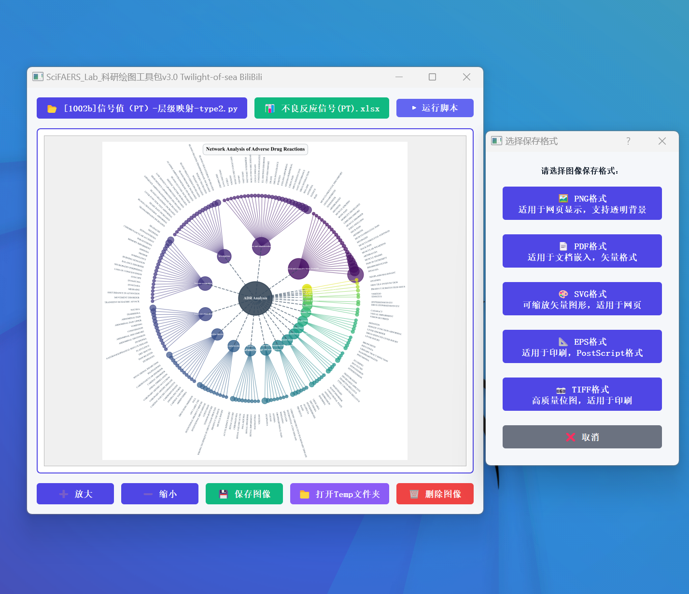
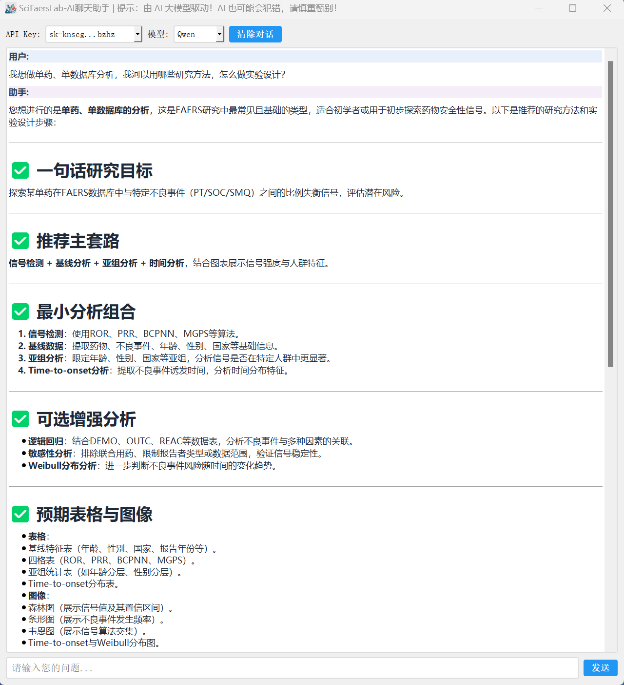

# SciFaersLab

**不用写 R、Python 或 SQL，从 FAERS 数据到论文级图表，一套图形化流程完成。**

覆盖 90% FAERS 数据挖掘论文套路 · Windows 10 / 11 · 零代码 · 季度数据库整合包

[国内访问 Gitee](https://gitee.com/Twilight-of-sea/sci-faers-lab)　·　[GitHub 备用镜像](https://github.com/TwilightOfSea/Sci-Faers-Lab-Clone)

SciFaersLab 面向医学、药学研究生、医生和科研人员，把数据整理、信号检测、统计分析和论文绘图放进同一个桌面工作流。订阅后从邮箱下载整合包，解压即可使用，不需要自行配置分析环境。

[**从零开始学习 FAERS 数据挖掘**](https://www.bilibili.com/video/BV1uifhYdEQn/)　·　[**观看软件完整运行**](https://www.bilibili.com/video/BV1AHeozNEXt/)

## 效果预览

输入目标药物，选择 ROR、PRR、MGPS、BCPNN，系统自动完成数据清洗、去重、信号计算和结果整理；执行进度、运行日志与输出目录集中在同一界面。

  

桌面分析系统：药物输入、算法选择、执行进度和运行日志同屏显示。

<table>
  <tr>
    <td width="50%" valign="top">
      
    </td>
    <td width="50%" valign="top">
      
    </td>
  </tr>
  <tr>
    <td align="center"><strong>信号检测</strong>：ROR、PRR、BCPNN、MGPS 联合森林图</td>
    <td align="center"><strong>统计建模</strong>：多因素 Logistic 回归结果与森林图</td>
  </tr>
  <tr>
    <td width="50%" valign="top">
      
    </td>
    <td width="50%" valign="top">
      
    </td>
  </tr>
  <tr>
    <td align="center"><strong>论文绘图</strong>：预览、保存并导出 PNG / PDF / SVG / EPS / TIFF</td>
    <td align="center"><strong>AI 助手</strong>：内置 FAERS 研究提示词，生成式回答需人工复核</td>
  </tr>
</table>

## 核心能力

| 模块 | 能完成什么 | 进一步了解 |
|---|---|---|
| **数据准备** | 内置季度数据库整合包；自动完成清洗、合并、去重和标准化 | [数据库范围和方法说明](./数据库范围和方法说明.md) |
| **信号检测** | ROR、PRR、MGPS、BCPNN；支持单药、多药、联用与自定义人群分析 | [操作说明](./软件操作说明.md#一不良数据库信号监测系统) |
| **统计建模** | 基线统计、亚组分析、Logistic 回归、机器学习、共病分析、韦伯分布与累积发生率 | [功能模块详解](./功能模块详解.md) |
| **论文绘图** | 161 个专业绘图脚本，覆盖 PT、SOC、森林图、火山图、韦伯分布等常用图表 | [绘图工具 v3.0](./绘图工具+部分脚本/绘图工具v3.0下载链接.md) |
| **拓展数据库** | JADER、CVARD、DDI、网络药理学和多药信号交联网络 | [功能目录](./功能模块详解.md#拓展模块) |
| **选题情报** | 9000 种药物发表情况、FAERS 文献信息与论文方法索引 | [选题信息](./选题信息.md) |

当前版本：**v1.60-26Q3**（2026-11-01 发布）  
[查看版本更新记录](./更新日志/v1.60版本更新日志.md)

## 学习与文档

| 我想 | 从这里开始 |
|---|---|
| 先系统学习 FAERS 数据挖掘 | [从零开始教学：入门课程 01](https://www.bilibili.com/video/BV1uifhYdEQn/) |
| 看软件实际运行 | [平台完整流程演示](https://www.bilibili.com/video/BV1AHeozNEXt/) |
| 查找全部功能 | [功能模块详解](./功能模块详解.md) |
| 学习具体操作 | [软件操作说明](./软件操作说明.md) |
| 设计研究方案 | [文章套路](./文章套路.md) |
| 参看选题信息 | [选题信息](./选题信息.md) / [FAERS 论文方法索引](https://datapod.space/faers-paper/) |
| 核对数据库范围与方法 | [数据库范围和方法说明](./数据库范围和方法说明.md) |
| 免费体验论文绘图 | [下载绘图工具 v3.0](./绘图工具+部分脚本/绘图工具v3.0下载链接.md) |

## 方案与价格

| 方案 | 价格 | 包含内容 |
|---|---:|---|
| 免费体验 | 0 元 | 绘图工具、部分绘图脚本、示例数据和教程 |
| 半年版 | 800 元 | 服务期内完整分析功能、全套脚本、季度数据库与版本更新 |
| 一年版 | 1,200 元 | 同上，服务期一年 |
| 永久版 | 单独报价 | 根据功能范围、设备和使用需求确认 |

完整版数据与模块更新后，会通过邮箱发送最新整合包，无需手动逐季度下载原始文件。  
免费绘图部分采用仓库 [LICENSE](./LICENSE) 所列许可；付费分析系统按设备授权。

## 开始使用

1. 观看[完整流程演示](https://www.bilibili.com/video/BV1AHeozNEXt/)，确认是否符合你的研究需求。
2. 免费体验[绘图工具 v3.0](./绘图工具+部分脚本/绘图工具v3.0下载链接.md)，或先阅读[软件操作说明](./软件操作说明.md)。
3. 如需完整分析系统，添加微信并备注来意。

  

使用环境：Windows 10 / 11 · 建议 8 GB 以上内存 · 至少 5 GB 可用空间

## 常见问题

**没有编程基础可以使用吗？**  
可以。数据整理、信号检测、统计分析和绘图均在图形界面完成，不需要写代码。

**免费版和完整版有什么区别？**  
免费版提供绘图工具、部分脚本和学习资料；完整版包含完整分析系统、全套脚本、季度数据库整合包和持续更新。

**数据库多久更新一次？**  
随 FDA 官方数据版本更新，并通过邮箱推送新的整合包。[日本 JADER](./拓展模块/Jader数据库挖掘工具.md)和[加拿大 CVARD](./拓展模块/CVARD加拿大数据库挖掘工具.md)也可按教程导入。

**购买后提供论文指导吗？**  
服务以软件使用指导和故障排查为主，不提供论文代写。

## 数据说明

FAERS 等自发报告数据库适合发现风险信号和生成研究假设，不能直接计算不良反应发生率，也不能单独证明药物与不良事件之间存在因果关系。研究成果应结合研究设计、临床背景和其他数据来源综合判断。

---

README 最后更新：2026-11-23
