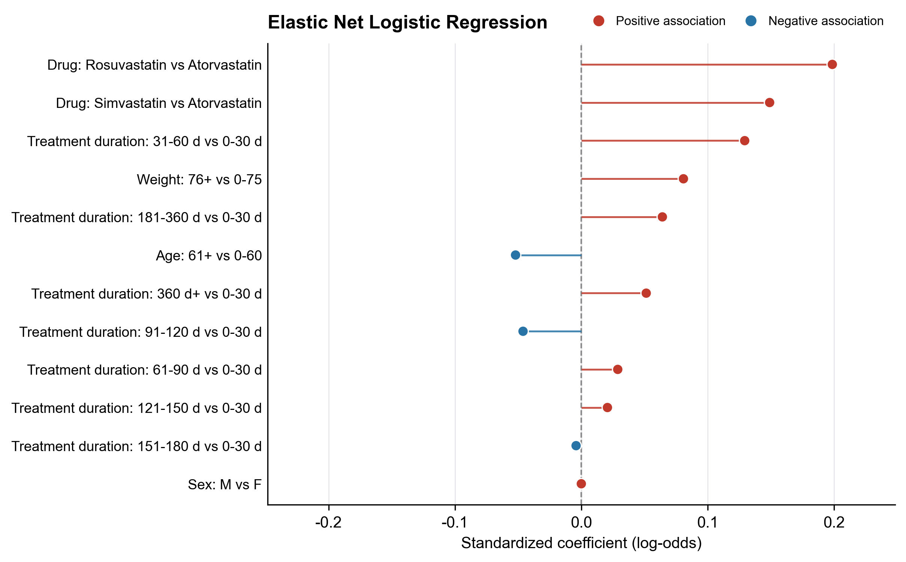
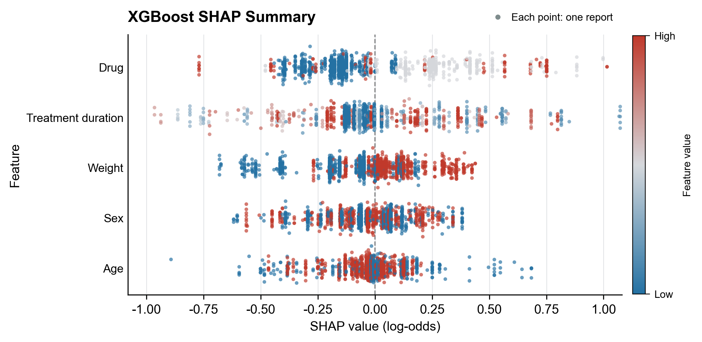
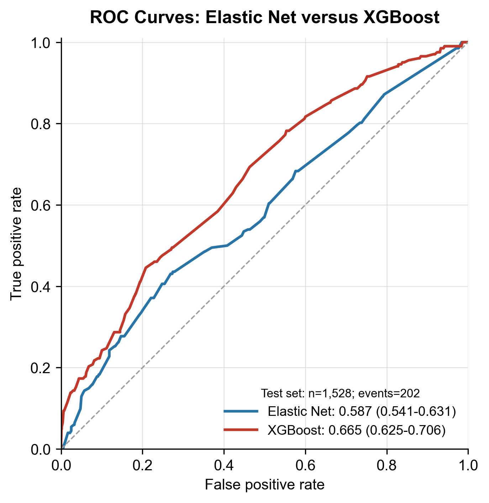
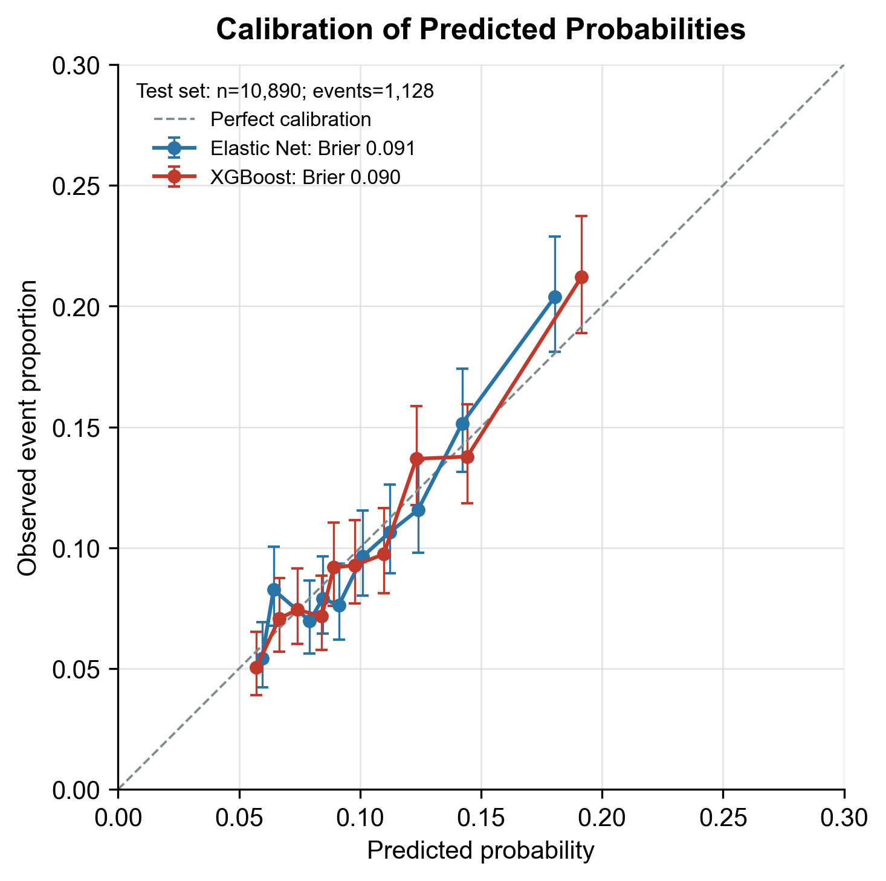
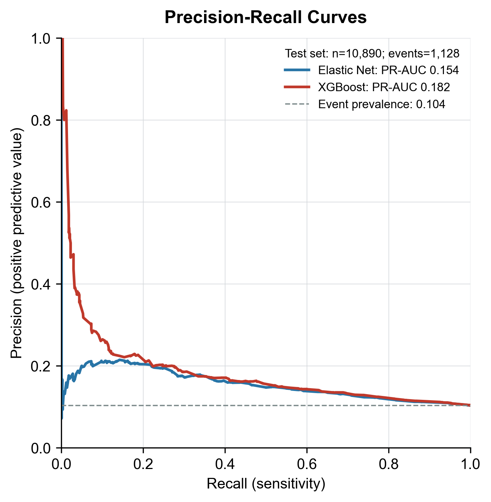

# FAERS 数据挖掘：Elastic Net、XGBoost 与机器学习预测模型解读

## 1. Elastic Net Logistic 与普通 Logistic Regression 的区别

### 1.1 普通 Logistic Regression

普通 Logistic Regression（如 `statsmodels.Logit`）通过最大似然估计拟合模型，不对回归系数施加惩罚：

\[
\max_{\beta}\sum_{i=1}^{n}
\left[y_i\log(p_i)+(1-y_i)\log(1-p_i)\right]
\]

其中，\(p_i\) 为样本发生目标事件的预测概率。

**主要特点：**
- 适合统计推断，可输出回归系数、标准误、P 值、OR 值及其 95% CI。
- 可以分析各变量与目标结局之间的调整后关联。
- 当变量较多、共线性严重、样本量不足或出现完全分离时，可能出现系数不稳定、标准误异常或模型无法收敛等问题。

### 1.2 Elastic Net Logistic Regression

Elastic Net 在 Logistic Regression 的损失函数中加入 L1 和 L2 正则化惩罚：

\[
\min_{\beta}
\left\{
-\log L(\beta)+
\lambda\left[
\alpha\|\beta\|_1+
\frac{1-\alpha}{2}\|\beta\|_2^2
\right]
\right\}
\]

其中：

- L1 惩罚：促使部分回归系数收缩至 0，实现特征筛选。
- L2 惩罚：使相关变量的系数更加稳定，降低过拟合风险。
- \(\lambda\)：控制整体惩罚强度。
- \(\alpha\)：控制 L1 与 L2 的相对比例。

在 scikit-learn 中，`l1_ratio` 对应上述 \(\alpha\)，`C` 通常与整体正则化强度呈反向关系。

**主要特点：**
- 适合高维变量、共线性较强的预测建模。
- 可以压缩不重要的变量系数，降低过拟合风险。
- 惩罚参数通常通过交叉验证选择。
- 不直接提供传统意义上可靠的标准误和 P 值，不能将普通 Logistic Regression 的推断方式直接套用到惩罚回归结果上。

如果需要进一步评估系数的不确定性，可以考虑 Bootstrap，但必须注意特征筛选过程也应纳入重抽样，否则可能低估不确定性。

### 1.3 两者的定位

| 对比项目 | 普通 Logistic | Elastic Net Logistic |
|---|---|---|
| 正则化 | 无 | L1 + L2 |
| 变量筛选 | 不会自动将系数压缩为 0 | 可以 |
| 共线性处理 | 容易受到影响 | 通常更稳定 |
| P 值、标准误 | 可以计算 | 不直接提供可靠的传统推断 |
| 主要用途 | 统计推断、关联分析 | 预测建模、特征筛选 |

**注意当前脚本的实际实现：**

当前脚本默认使用普通 Logistic Regression；只有普通模型拟合失败时，才使用 `fit_regularized(method='l1')` 进行回退。

这属于 LASSO（L1 正则化），并不是完整的 Elastic Net（L1 + L2）。

因此，如果要在论文或教程中称其为 Elastic Net Logistic Regression，需要确认实际代码使用了同时包含 L1 和 L2 惩罚的模型。

---

## 2. 与传统 Logistic 回归分析有什么区别？

传统 Logistic 回归通常关注变量与结局之间的统计关联，而这里建立的是一套完整的机器学习预测建模流程。

主要区别在于：

| 对比项目 | 传统 Logistic 回归 | 机器学习预测建模 |
|---|---|---|
| 主要目的 | 分析变量与结局的关联 | 预测新样本的结局 |
| 数据划分 | 可以使用全部数据 | 通常划分训练集和测试集 |
| 模型训练 | 直接拟合回归模型 | 训练集拟合、交叉验证调参 |
| 变量筛选 | 依赖研究设计和统计方法 | 可以使用正则化、特征重要性等方法 |
| 性能评价 | OR、P 值、95% CI | AUC、PR-AUC、校准度、Brier Score 等 |
| 模型解释 | 回归系数、OR | 系数、SHAP 等 |

### 2.1 训练集与测试集

首先将数据划分为训练集和测试集。

- **训练集（Training Set）**：用于模型拟合、特征处理和超参数调优。
- **测试集（Test Set）**：用于最终评估模型在未参与训练的数据上的表现。

测试集不能参与特征筛选、超参数调优或模型选择，否则会产生数据泄漏，使最终性能评价过于乐观。

### 2.2 网格搜索与 5 折分层交叉验证

当前流程使用：

- `GridSearchCV`：搜索不同的超参数组合。
- `StratifiedKFold`：进行 5 折分层交叉验证，尽可能保持每折阳性和阴性样本比例一致。

具体流程：

1. 将训练集分成 5 份。
2. 每次使用其中 4 份训练模型，剩余 1 份验证。
3. 重复 5 次，使每份数据都参与一次验证。
4. 比较不同超参数组合的验证表现。
5. 选择表现较好的参数组合，重新在完整训练集上拟合模型。

**为什么能够生成 ROC 和 PR 曲线？**

因为模型不仅可以输出分类结果，还可以输出每个样本属于阳性类别的预测概率。

通过改变判定阈值，可以得到不同的 TPR、FPR、Precision 和 Recall，进而绘制 ROC 曲线和 PR 曲线。

### 2.3 交叉验证与独立测试集的区别

需要区分两个概念：

- 交叉验证：用于训练过程中的模型选择和内部性能评估。
- 独立测试集：用于模型确定后的最终性能评价。

如果使用网格搜索反复选择超参数，再直接将最佳组合的最高交叉验证 AUC 作为无偏性能估计，可能存在一定的选择偏倚。

更严格的内部验证方式是嵌套交叉验证（Nested CV），外层评估模型性能，内层负责超参数调优。

无论是否采用嵌套交叉验证，独立测试集都应保持完全独立。

---

## 3. 样本量与 EPV 要求

预测模型需要足够的样本量，尤其需要关注阳性事件数量。

EPV（Events Per Variable）指每个模型参数对应的阳性事件数：

\[
EPV=\frac{\text{阳性事件数}}{\text{模型参数数目}}
\]

常见经验标准：

- EPV ≥ 10：传统经验下的基本参考。
- EPV ≥ 20：通常更加稳妥。

例如，假设模型包含 6 个参数：

| EPV | 所需阳性事件数 |
|---|---:|
| 10 | 60 |
| 20 | 120 |

如果阳性事件发生率为 10%，那么对应的总样本量分别约为 600 和 1200。

**重要：600 或 1200 不是固定的总样本量要求。**

实际需要根据以下因素综合判断：

- 阳性事件发生率。
- 模型参数数量，而不是简单计算变量名称数量。
- 分类变量展开后的哑变量数量。
- 模型复杂度及预期预测性能。
- 是否存在特征筛选和超参数调优。
- 训练集与测试集的划分比例。

例如，一个包含 5 个原始变量的模型，如果经过 One-hot 编码后变成 12 个参数，就不能简单按照 5 个变量计算 EPV。

对于 XGBoost 等复杂模型，传统 EPV 规则并不能充分反映模型所需样本量，还需要结合模型复杂度、事件数量及验证结果判断。

---

## 4. 预测变量的选择：为什么不建议直接纳入 PT 和 SOC？

### 4.1 默认纳入的基础变量

当前模型考虑的基础变量包括：

- 年龄（Age）
- 性别（Sex）
- 发病时间（Time to Onset）
- 体重（Weight）
- 药物类型（Drug Type）

这些变量可以作为候选预测因素，但仍需根据实际研究目的、数据完整性和变量可获得时间进行筛选。

尤其需要注意：发病时间只有在预测时已经能够获得的情况下，才能作为预测变量。如果预测目标是事件发生前的风险预测，那么事件发生后的 TTO 信息属于未来信息，不能用于预测。

### 4.2 为什么不建议将 PT 和 SOC 直接作为预测变量？

这是 FAERS 预测建模中容易出现的问题。

- PT（Preferred Term）：描述具体的不良事件。
- SOC（System Organ Class）：PT 所属的上级系统器官分类。

它们本质上描述的是已经发生或被报告的不良事件，而不是独立于结局的基础特征。

如果研究目标是预测某个严重结局，却将与该结局直接相关的 PT 或 SOC 纳入预测变量，可能产生：

**① 结局泄漏（Outcome Leakage）**

模型提前获得了与目标结局高度相关的信息，导致测试集 AUC 虚高。

**② 循环论证**

例如，用描述严重临床事件的 PT/SOC 预测严重结局，模型可能只是在识别结局本身，而不是发现真正具有预测价值的因素。

**③ 特征冗余与共线性**

PT 和 SOC 存在上下级分类关系，同时纳入可能引入冗余信息，影响模型稳定性。

**④ SHAP 解释不稳定**

当 PT 和 SOC 包含相同或高度重叠的信息时，SHAP 可能将模型贡献分配到不同层级的特征上，使重要性解释不稳定。

因此，如果研究目的是探索人口学特征、药物类型等因素对不良结局的预测能力，应优先使用结局发生前或预测时能够获得的基础变量。

如果研究目的是基于完整不良事件报告识别报告特征，则 PT/SOC 可以作为预测信息，但必须明确研究场景，不能将其结果解释为事件发生前的风险预测或因果影响因素。

---

## 5. 模型训练流程与结果输出

### 5.1 整体流程

当前方案包含两个不同类型的模型：

**① Elastic Net Logistic Regression**

- 采用 L1 + L2 正则化。
- 自动压缩部分变量系数，进行特征筛选。
- 输出标准化回归系数及 OR（如果需要）。
- 适合分析相对线性的特征关联，能够缓解共线性和过拟合问题。

需要注意，标准化系数与 OR 的含义不同。OR 应由原始量纲下的回归系数计算，不能直接对标准化系数取指数后当作原始变量的 OR。

**② XGBoost**

- 基于梯度提升树的集成学习模型。
- 能够捕捉非线性关系和特征之间的交互作用。
- 不要求变量与结局之间满足线性关系。
- 通过 SHAP 分析模型的特征贡献。

XGBoost 更适合复杂的预测任务，但其特征重要性不直接代表因果效应。

### 5.2 SHAP 分析

脚本内置 `_build_shap_table()`，在测试集上计算 SHAP 值。

这里需要区分：

- 模型训练使用训练集。
- SHAP 解释使用测试集样本。
- 测试集上的 SHAP 结果反映模型如何对这些未参与训练的样本进行预测。

这种做法有助于评价模型在独立样本上的特征贡献模式。

另外，One-hot 编码会将原始分类变量拆分成多个哑变量。例如：

- `sex`
- `age_group`
- `wt_group`
- `dur_group`

如果脚本将这些哑变量的 SHAP 值重新聚合为原始变量，应确保采用合理的聚合方法。常见方式是对同一原始变量对应的 SHAP 值求和，再计算聚合后的绝对值重要性。

需要注意：不同类别的 SHAP 值可能方向不同，因此不能简单将各哑变量的绝对 SHAP 值相加后，再将其解释为原始变量对单个样本的净贡献。

### 5.3 建议输出的模型评价指标

| 指标 | 作用 |
|---|---|
| 5 折交叉验证 AUC | 训练阶段的内部性能评估 |
| 独立测试集 AUC | 评价模型的区分能力 |
| AUC 的 95% Bootstrap CI | 评价 AUC 估计的不确定性 |
| PR-AUC | 评价阳性类别识别能力 |
| 校准曲线 | 评价预测概率与实际发生率的一致性 |
| 校准截距和斜率 | 评价预测概率的系统性偏差 |
| Brier Score | 评价整体概率预测误差 |
| SHAP | 解释 XGBoost 的特征贡献 |

如果同时比较 XGBoost 和 Elastic Net，可以在相同测试集上计算两者的 AUC 差值，并通过配对 Bootstrap 获得差值的 95% CI。

\[
\Delta AUC=AUC_{\text{XGBoost}}-AUC_{\text{ElasticNet}}
\]

Bootstrap 时应对同一批测试样本进行配对重抽样，保持两个模型的预测结果一一对应。

如果差值的 95% CI 不包含 0，说明两种模型的 AUC 差异具有统计学意义（在相应 Bootstrap 推断条件下）。

注意：比较 AUC 时，不能仅凭两个模型各自的置信区间是否重叠来判断差异是否显著。

---

## 6. 五类结果图的解读

### 6.1 Elastic Net 系数棒棒糖图（Coefficient Lollipop Plot）

<figure>

</figure>

**回答的问题：哪些变量与目标结局相关？方向和强度如何？**

棒棒糖图通常以横轴表示回归系数，纵轴表示变量名称。

- 系数大于 0：该变量与更高的模型预测结局概率相关。
- 系数小于 0：该变量与更低的模型预测结局概率相关。
- 系数绝对值越大：在相同标准化尺度下，模型赋予该变量的关联权重越大。

如果展示的是标准化回归系数，正负方向仍然可以解释，但不同变量的系数大小需要结合标准化方式理解。

如果展示的是原始 Logistic 回归系数，可以转换为 OR：

\[
OR=e^\beta
\]

- OR > 1：与更高的结局发生优势相关。
- OR < 1：与更低的结局发生优势相关。
- OR = 1：没有明显的优势比变化。

**注意：OR 是优势比（Odds Ratio），不是相对风险（Risk Ratio）。**

此外，Elastic Net 的系数经过正则化收缩，不能直接按照普通 Logistic 回归的 P 值和置信区间进行统计推断。

因此，棒棒糖图主要用于展示模型中的特征方向和相对权重，不能直接证明变量具有因果作用。

### 6.2 XGBoost SHAP Summary Plot

<figure>

</figure>

**回答的问题：XGBoost 如何利用不同特征进行预测？**

SHAP 是一种模型解释方法，用于将单个样本的模型输出分解为各个特征的贡献。

其基本关系为：

\[
f(x)=E[f(X)]+\sum_{j=1}^{M}\phi_j
\]

其中：

- \(f(x)\)：当前样本的模型输出。
- \(E[f(X)]\)：模型的基准输出。
- \(\phi_j\)：第 \(j\) 个特征的 SHAP 值。

**SHAP 值的解释：**

- 正 SHAP 值：该特征使模型输出高于基准值。
- 负 SHAP 值：该特征使模型输出低于基准值。
- SHAP 绝对值越大：该特征对当前样本预测结果的影响越大。
- 平均绝对 SHAP 值：可以用于对特征进行全局重要性排序。

注意，SHAP 值的正负方向应结合模型输出尺度解释。

如果解释的是预测概率，正值表示提高预测概率；如果解释的是 Log-odds 等原始模型输出，正值表示提高模型输出，而不一定等于相同幅度的概率变化。

**SHAP 不代表因果效应。**

某个变量具有较高 SHAP 重要性，只能说明模型在预测时较多地利用了该变量，不能证明该变量是结局发生的独立原因。

### 6.3 ROC 曲线与 AUROC

<figure>

</figure>

**回答的问题：模型能否区分阳性样本和阴性样本？**

ROC 曲线反映不同判定阈值下，真正率（TPR）与假正率（FPR）之间的关系。

\[
TPR=\frac{TP}{TP+FN}
\]

\[
FPR=\frac{FP}{FP+TN}
\]

其中：

- TPR：真正率，也就是敏感度（Sensitivity）。
- FPR：假正率，即将阴性样本错误识别为阳性的比例。

AUROC 是 ROC 曲线下面积，主要评价模型对阳性和阴性样本的排序区分能力。

常见的经验性参考：

| AUROC | 常见解释 |
|---|---|
| 0.5 | 接近随机区分 |
| 0.6–0.7 | 区分能力较弱 |
| 0.7–0.8 | 一定的区分能力 |
| 0.8–0.9 | 较好的区分能力 |
| > 0.9 | 很强的区分能力 |

以上仅为经验参考，不是统一的评价标准，实际还需要结合研究场景、置信区间和临床意义判断。

**特别注意：**

- AUROC 高不代表预测概率准确。
- AUROC 高不代表模型具有因果解释能力。
- AUROC 高不代表模型在实际应用中一定有价值。
- AUROC 不受分类阈值固定选择的直接影响。

因此，需要结合校准曲线和其他评价指标综合判断模型表现。

### 6.4 校准曲线与 Brier Score

<figure>

</figure>

**回答的问题：模型预测的概率是否接近实际发生率？**

ROC-AUC 主要衡量排序能力，而校准分析关注预测概率是否准确。

例如，模型预测某组样本发生目标事件的概率为 20%，如果该组实际约有 20% 的样本发生目标事件，说明预测概率与实际发生率较为一致。

#### ① 校准曲线

- X 轴：模型预测的事件概率。
- Y 轴：对应概率区间内实际观察到的事件发生率。
- 45° 对角线：理想校准状态。

曲线越接近对角线，说明预测概率与实际发生率越一致。

#### ② 校准截距（Calibration Intercept）

理想值为 0。

通常通过以下 Logistic 再校准模型估计：

\[
\operatorname{logit}(Y)=a+b\operatorname{logit}(\hat p)
\]

其中 \(a\) 为校准截距。

- 截距 > 0：整体上模型倾向于低估事件发生概率。
- 截距 < 0：整体上模型倾向于高估事件发生概率。

#### ③ 校准斜率（Calibration Slope）

理想值为 1。

- 斜率 < 1：预测概率过于极端，常见于模型过拟合。
- 斜率 > 1：预测概率变化幅度不足，模型表现得相对保守。

校准截距和斜率需要结合具体估计方法和样本分布解释。

#### ④ Brier Score

Brier Score 衡量预测概率与真实 0/1 结局之间的均方误差：

\[
BS=\frac{1}{N}\sum_{i=1}^{N}(\hat p_i-y_i)^2
\]

其中：

- \(\hat p_i\)：模型预测概率。
- \(y_i\)：实际结局，取值为 0 或 1。
- \(N\)：样本数量。

对于二分类问题，Brier Score 越低越好，0 表示完美预测。

Brier Score 同时受到区分能力和校准程度的影响，因此不能将其完全视为单纯的校准指标。

**ROC-AUC 与校准评价的区别：**

即使 XGBoost 的 AUROC 高于 Elastic Net，也不代表它的预测概率一定更准确。

例如，XGBoost 可能能够更好地区分阳性和阴性样本，但预测概率整体偏高；Elastic Net 的 AUROC 可能略低，却具有更好的概率校准。

### 6.5 PR 曲线与 PR-AUC

<figure>

</figure>

**回答的问题：当阳性样本较少时，模型识别阳性样本的能力如何？**

PR 曲线主要关注阳性类别，尤其适用于事件发生率较低、类别不平衡的数据。

核心指标：

| 指标 | 计算方式 | 含义 |
|---|---|---|
| Precision（精确率） | TP / (TP + FP) | 预测为阳性的样本中，实际阳性的比例 |
| Recall（召回率） | TP / (TP + FN) | 所有实际阳性样本中，被成功识别的比例 |
| PR-AUC | PR 曲线下面积 | 综合评价不同阈值下精确率与召回率的表现 |

其中：

- Precision 越高，说明误报越少。
- Recall 越高，说明漏报越少。
- PR-AUC 越大，通常说明模型对阳性类别的识别表现越好。

**PR 曲线的基准线：**

随机预测模型的 PR-AUC 基线与阳性事件发生率有关，而不是固定为 0.5。

例如，测试集中：

- 总样本量：10,890。
- 阳性事件数：1,128。
- 事件发生率：

\[
\frac{1128}{10890}\approx 0.104
\]

因此，随机预测基准精确率约为 0.104。

如果模型的 PR-AUC 高于这一基准，说明其具有一定的阳性识别能力。

**PR-AUC 的解读注意事项：**

1. PR-AUC 越高通常越好。
2. 需要与当前研究的阳性事件发生率结合解读。
3. PR-AUC 会受到阳性事件发生率影响，不宜脱离事件率直接比较不同研究。
4. 相同的 PR-AUC 在不同事件率的数据集中，实际意义可能不同。

例如，事件率为 13% 时，PR-AUC 为 0.20 可能具有一定的预测增益；但在事件率仅为 2% 的研究中，同样的 PR-AUC 不能直接认为具有相同表现。

**如何解读模型差异？**

如果 XGBoost 在低召回率区间具有更高的 Precision，说明它在优先筛选少量高可信度阳性样本时可能更有优势。

如果两条曲线在高召回率区间逐渐接近，说明随着识别更多阳性样本，两种模型的精确率差距可能缩小。

实际应用时，应根据研究目的选择合适的 Precision-Recall 权衡，而不是只看 PR-AUC。

---

## 7. 五类结果图应该如何安排？

| 图表 | 主要回答的问题 | 建议位置 |
|---|---|---|
| Elastic Net 系数棒棒糖图 | 哪些特征与结局相关，方向如何？ | 主图核心 |
| XGBoost SHAP Summary | XGBoost 如何利用不同特征进行预测？ | 主图核心 |
| ROC 曲线 / AUROC | 模型能否区分阳性和阴性样本？ | 主模型性能 |
| 校准曲线 | 预测概率是否接近实际发生率？ | 重要补充或主图 |
| Brier Score | 整体预测概率误差有多大？ | 性能表 |
| PR 曲线 / PR-AUC | 阳性样本较少时，模型如何平衡精确率与召回率？ | 重要补充 |

建议将五类图按照以下逻辑组织：

1. **先解释模型特征**：Elastic Net 系数图和 XGBoost SHAP 图。
2. **再展示模型区分能力**：ROC 曲线与 AUROC。
3. **进一步评价概率准确性**：校准曲线与 Brier Score。
4. **最后补充阳性识别能力**：PR 曲线与 PR-AUC。

这样可以从特征解释、区分能力、概率校准和阳性识别四个角度，较完整地评价预测模型。

---

## 8. FAERS 预测建模的额外注意事项

### 8.1 区分预测与关联分析

预测模型回答的是：模型能否利用已有信息识别目标结局？

关联分析回答的是：某个变量与目标结局之间是否存在统计关联？

SHAP、Elastic Net 系数和 XGBoost 特征重要性都不能直接证明因果关系。

### 8.2 注意数据泄漏

除了 PT 和 SOC，还应检查：

- 是否将目标结局的直接编码或衍生变量纳入预测因素。
- 是否使用了结局发生后才获得的信息。
- 是否在数据划分之前使用全体数据进行特征筛选或标准化。
- 是否在测试集上反复选择模型或调整参数。

所有需要从数据中学习的预处理步骤，例如缺失值填补、标准化和特征筛选，都应在交叉验证的训练折内拟合，再应用于对应验证折。

### 8.3 注意 FAERS 数据的特殊性

FAERS 是自发报告数据库，报告数据存在选择性报告、重复报告、缺失信息和报告偏倚等问题。

因此，基于 FAERS 建立的预测模型，主要反映特定数据集和研究条件下的预测关系。

不能直接将其预测概率解释为一般人群的真实不良事件发生风险，也不能将模型输出直接用于临床风险决策。

如果同一患者或同一病例存在多条关联报告，应尽量避免相关记录同时进入训练集和测试集，否则可能造成信息泄漏。应根据数据结构考虑按病例、患者或报告来源进行分组划分。

### 8.4 建议增加外部验证

独立测试集能够评价模型在当前数据来源内部的泛化能力，但不等于外部验证。

如果条件允许，可以使用不同时间段、不同数据库或不同数据来源进行验证，以评价模型在不同数据环境下的稳定性。

---

## 9. 总结

Elastic Net Logistic 和 XGBoost 分别代表两种不同的建模思路：

- **Elastic Net Logistic**：通过 L1 + L2 正则化筛选变量，模型结构相对简单，具有较好的可解释性。
- **XGBoost**：能够捕捉非线性关系和复杂交互，通过 SHAP 解释特征对预测结果的贡献。

五类结果图分别回答不同问题：

- 系数棒棒糖图：变量与结局的关联方向和权重。
- SHAP 图：模型如何利用不同变量进行预测。
- ROC 曲线：模型区分阳性与阴性的能力。
- 校准曲线：模型预测概率是否准确。
- PR 曲线：模型识别阳性样本时的精确率与召回率如何平衡。

**完整的预测模型评价不能只看 AUROC。**

应同时考虑区分能力、概率校准、阳性识别能力和独立验证结果，才能更全面地评价模型的预测性能。