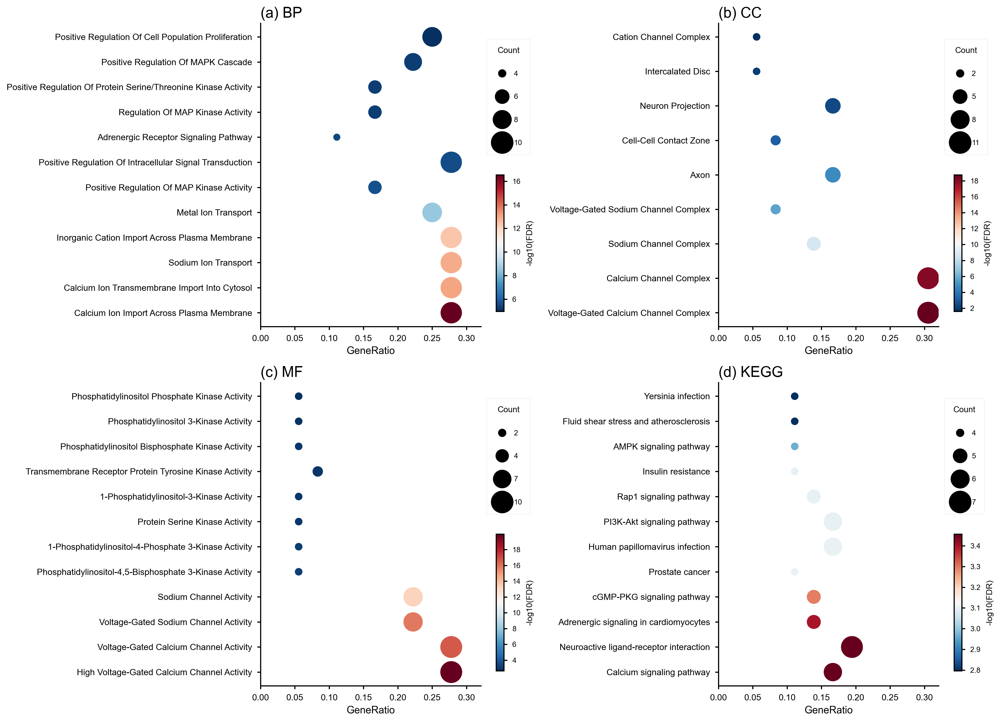
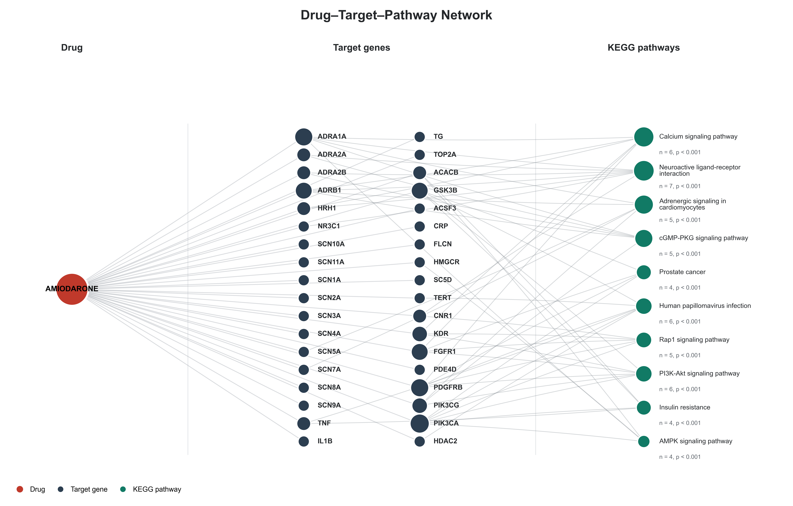
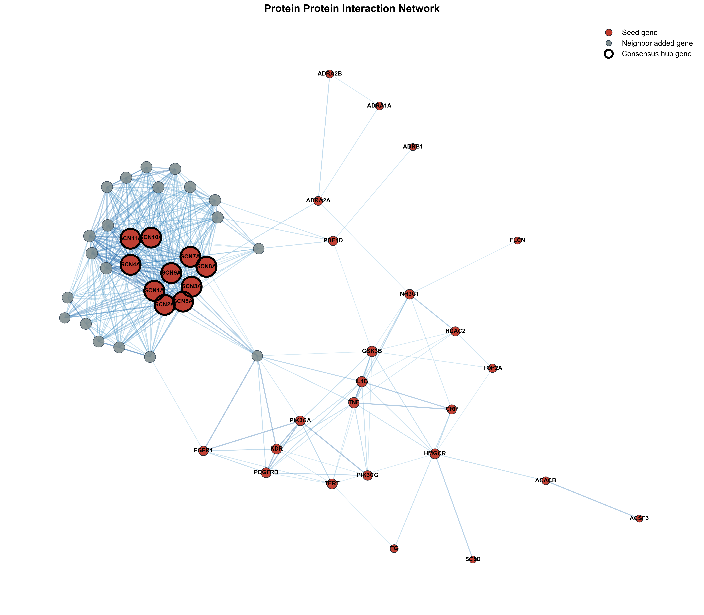

## SciFaersLab整合包 V1.60 版本更新日志

**项目地址：**
- Gitee: https://gitee.com/Twilight-of-sea/sci-faers-lab
- Github: https://github.com/TwilightOfSea/Sci-Faers-Lab-Clone

---

### 一、数据库更新

#### FAERS 数据库
- 已更新至 2026Q3 版本
- 累积数据覆盖：2004Q1 至 2026Q3，共计 91 个季度

#### JADER 数据库
- 已更新至 202610 版本
- 下载链接：[JADER官网](https://www.pmda.go.jp/safety/info-services/drugs/adr-info/suspected-adr/0005.html)

#### CVARD 数据库
- 已更新至最新版本：The data set is updated on a monthly basis and currently covers the following time period: 1965 to **2026-06-30**. &#x20;
- 下载链接：[Government of Canada](https://www.canada.ca/en/health-canada/services/drugs-health-products/medeffect-canada/adverse-reaction-database/medeffect-canada-caveat-privacy-statement-interpretation-data-search-canada-vigilance-adverse-reaction-online-database.html)

### 二、网络药理学拓展模块更新

- 完善 FAERS 数据挖掘与网络药理学联动分析流程，覆盖“药物靶点筛选 - 疾病关联靶点 - 富集分析 - 药物-靶点-通路网络 - PPI 与 Hub 靶点筛选”的完整分析链路
- 新增网络药理学专用工具：
  - ChEMBL 数据库靶点检索工具，可根据目标药物获取潜在作用靶点
  - 疾病表型关联靶点检索工具，可结合 HPO 表型编号与 Open Targets 获取疾病关联靶点
  - Set-Venn-Tool 网页工具，用于药物靶点与疾病靶点的合并、去重及交集筛选
- 支持 BP、CC、MF 和 KEGG 经典富集分析，可一键生成富集图，并在 Temp 文件夹中保存详细结果表
- 支持药物-靶点-KEGG 通路网络图绘制，可导出 png、pdf、svg、eps、tiff 等格式
- 新增蛋白互作网络构建与算法赋分工具，可自动请求 STRING 数据库，完成 Degree、MCC、MNC、DMNC、EPC 五种算法打分，并按“至少 N 种算法进入 Top 10”筛选 Hub 靶点
- 补充可选分子对接流程，用于在分子层面辅助验证药物小分子与 Hub 靶蛋白的理论结合潜力
- 详细操作流程：[网络药理学拓展模块](https://github.com/TwilightOfSea/Sci-Faers-Lab-Clone/blob/master/%E6%8B%93%E5%B1%95%E6%A8%A1%E5%9D%97/%E7%BD%91%E7%BB%9C%E8%8D%AF%E7%90%86%E5%AD%A6%E6%8B%93%E5%B1%95%E6%A8%A1%E5%9D%97.md)

### 三、绘图脚本库扩充与优化

**脚本数量：** 扩展至 161 个专业绘图脚本，适配于三大数据库的分析图像绘制

**新增两药 ROR 对比森林图脚本：**
- `[P1009a]两药-ROR对比森林图-Top30共有PT`
  - 自动读取工作簿中的前两个工作表，分别作为药物 1 和药物 2 的对比数据
  - 匹配两个药物共有的 PT，并按两药合计频数选取 Top 30
  - 计算 ROR 及 99% CI，按 99% CI 是否跨过 1 判断差异并绘制森林图
  - 同步导出森林图与 Excel 结果表

- `[P1009b]两药-ROR对比森林图-Top30共有PT-BioP_value`
  - 在 `[P1009a]` 的基础上，增加原始 P 值、检验方法和 Bonferroni 校正 P 值
  - 根据期望频数自动选择 Fisher 精确检验、连续性校正卡方检验或 Pearson 卡方检验
  - 森林图同时展示 P 值与 Bonferroni P 值，并按校正后的显著性判断着色
  - Excel 结果表保留 P 值、检验方法和 Bonferroni P 值，便于论文复现与结果核查

### 四、情报数据更新

#### FAERS 数据库情报
- 药物样本量统计：更新 9000 种药物在 FAERS 数据库中的样本量-发文数量对应表，便于查看目标药物的发表情况、药理信息、说明书不良反应及特定人群用药信息，为选题提供参考依据

- 文献收录：更新 NCBI 数据库中所有 FAERS 相关论文的收录情况

### 历史更新日志：
- [v1.59版本更新日志.md](https://gitee.com/Twilight-of-sea/sci-faers-lab/blob/master/%E6%97%A7%E7%89%A9/v1.59%E7%89%88%E6%9C%AC%E6%9B%B4%E6%96%B0%E6%97%A5%E5%BF%97.md)
- [v1.58版本更新日志.md](https://gitee.com/Twilight-of-sea/sci-faers-lab/blob/master/%E6%97%A7%E7%89%A9/v1.58%E7%89%88%E6%9C%AC%E6%9B%B4%E6%96%B0%E6%97%A5%E5%BF%97.md)
- [v1.57版本更新日志.md](https://gitee.com/Twilight-of-sea/sci-faers-lab/blob/master/%E6%97%A7%E7%89%A9/v1.57%E7%89%88%E6%9C%AC%E6%9B%B4%E6%96%B0%E6%97%A5%E5%BF%97.md)
- [v1.56版本更新日志.md](https://gitee.com/Twilight-of-sea/sci-faers-lab/blob/master/%E6%97%A7%E7%89%A9/v1.56%E7%89%88%E6%9C%AC%E6%9B%B4%E6%96%B0%E6%97%A5%E5%BF%97.md)
- [v1.55版本更新日志.md](https://gitee.com/Twilight-of-sea/sci-faers-lab/blob/master/%E6%97%A7%E7%89%A9/v1.55%E7%89%88%E6%9C%AC%E6%9B%B4%E6%96%B0%E6%97%A5%E5%BF%97.md)
- [v1.54版本更新日志.md](https://gitee.com/Twilight-of-sea/sci-faers-lab/blob/master/%E6%97%A7%E7%89%A9/v1.54%E7%89%88%E6%9C%AC%E6%9B%B4%E6%96%B0%E6%97%A5%E5%BF%97.md)
- [v1.53版本更新日志.md](https://gitee.com/Twilight-of-sea/sci-faers-lab/blob/master/%E6%97%A7%E7%89%A9/v1.53%E7%89%88%E6%9C%AC%E6%9B%B4%E6%96%B0%E6%97%A5%E5%BF%97.md)
- [v1.52版本更新日志.md](https://gitee.com/Twilight-of-sea/sci-faers-lab/blob/master/%E6%97%A7%E7%89%A9/v1.52%E7%89%88%E6%9C%AC%E6%9B%B4%E6%96%B0%E6%97%A5%E5%BF%97.md)
- [v1.51版本更新日志.md](https://gitee.com/Twilight-of-sea/sci-faers-lab/blob/master/%E6%97%A7%E7%89%A9/v1.51%E7%89%88%E6%9C%AC%E6%9B%B4%E6%96%B0%E6%97%A5%E5%BF%97.md)
- [v1.50版本更新日志.md](https://gitee.com/Twilight-of-sea/sci-faers-lab/blob/master/%E6%97%A7%E7%89%A9/v1.50%E7%89%88%E6%9C%AC%E6%9B%B4%E6%96%B0%E6%97%A5%E5%BF%97.md)
- [v1.4版本更新日志.md](https://gitee.com/Twilight-of-sea/sci-faers-lab/blob/master/%E6%97%A7%E7%89%A9/v1.4%E7%89%88%E6%9C%AC.md)

---

*更新日期：2026年10月*
