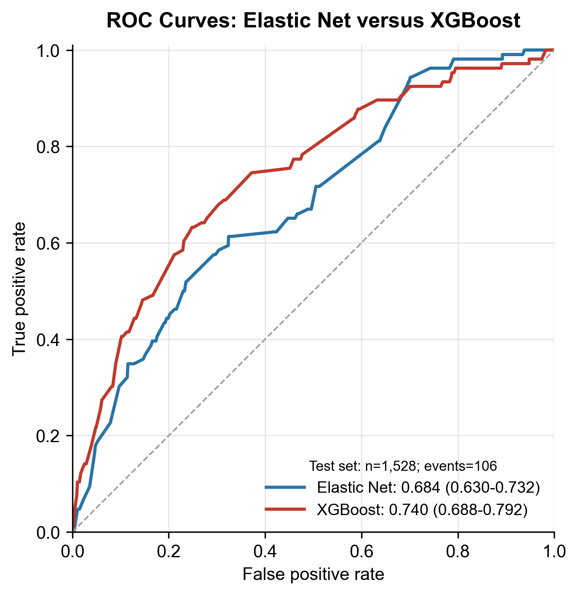
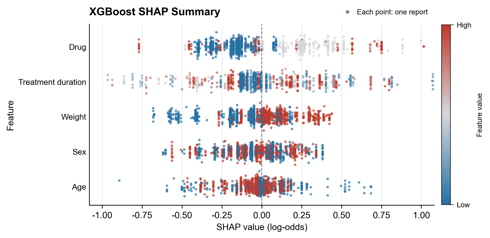
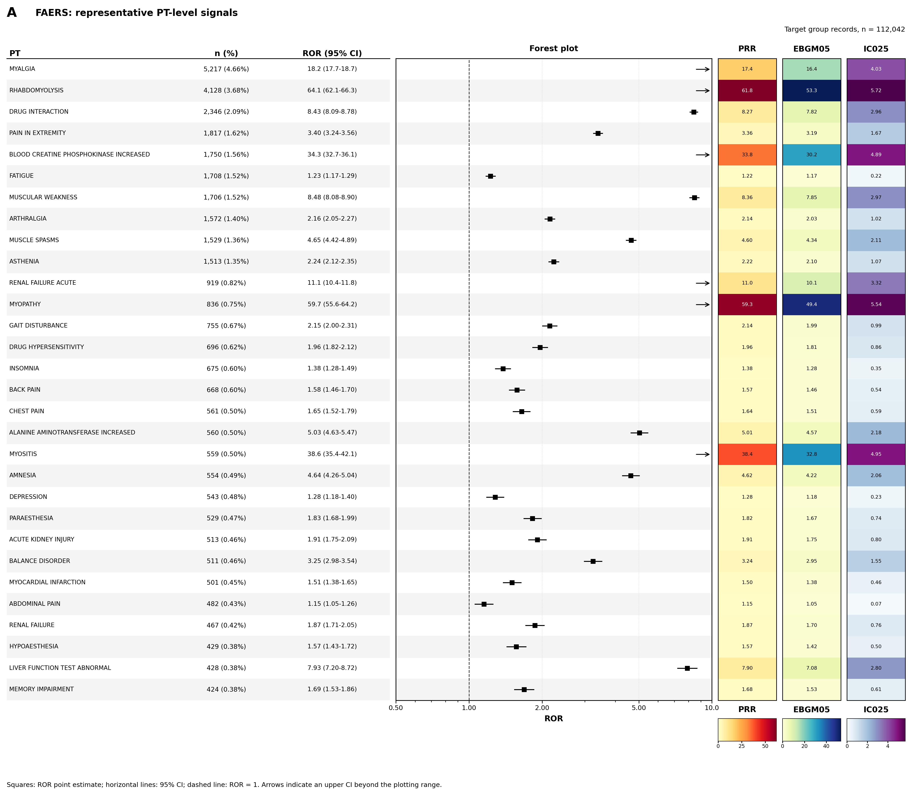
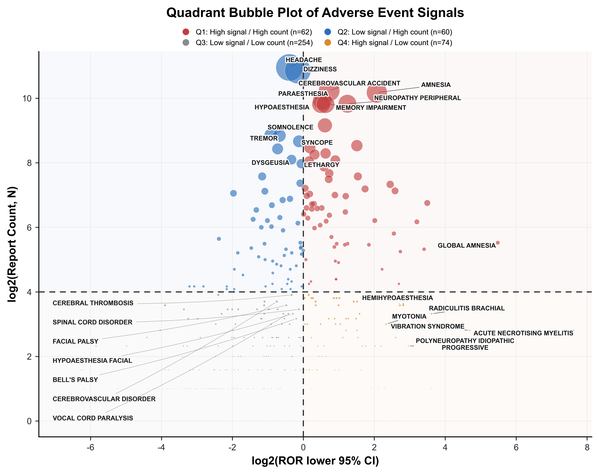
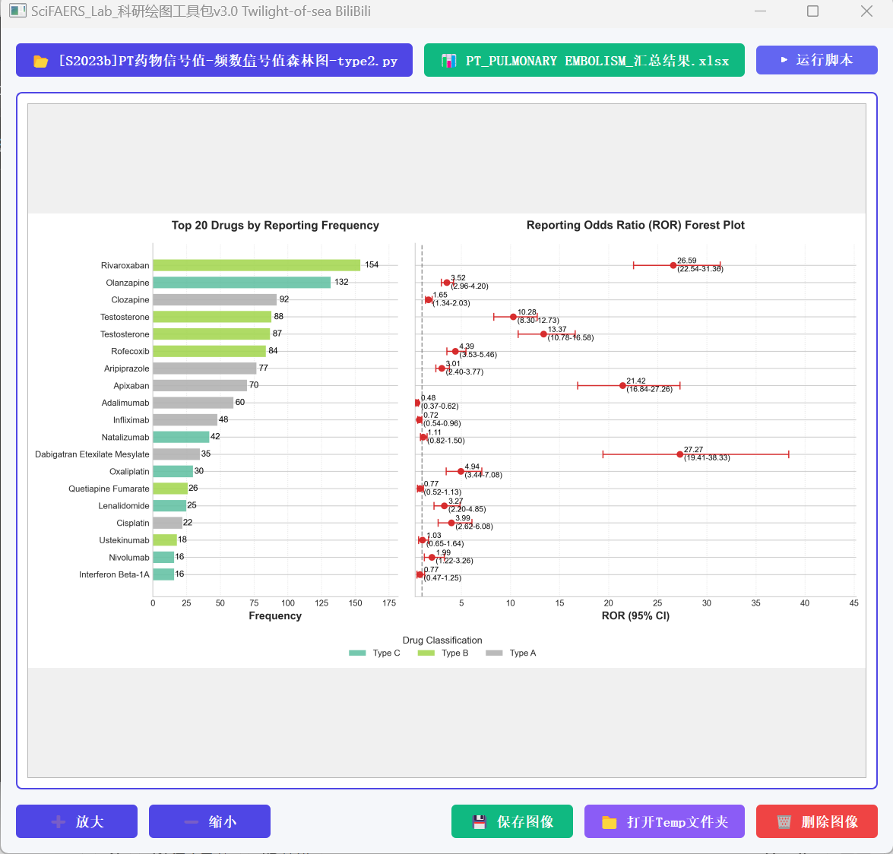

## SciFaersLab整合包 V1.61 版本更新预告

**项目地址：**
- Gitee: https://gitee.com/Twilight-of-sea/sci-faers-lab
- Github: https://github.com/TwilightOfSea/Sci-Faers-Lab-Clone

---

### 一、数据库与词典更新

#### FAERS 数据库
- 本次为可选更新，FAERS 数据库版本仍为 2026Q3

#### JADER 与 CVARD 数据库
- 若数据库发布新版本，将同步推送相关更新
- 预计于 12 月推送

#### MedDRA 词典
- 内置 MedDRA 词典更新至 v29.1

### 二、功能增量更新

#### 逻辑回归与 XGBoost 预测模型
- 新增逻辑回归与 XGBoost 预测模型系列脚本
- 教学文档：[多元 Logistic 回归 + 机器学习预测](https://gitee.com/Twilight-of-sea/sci-faers-lab/blob/master/%E5%88%86%E6%9E%90%E6%96%B9%E6%B3%95/%E5%A4%9A%E5%85%83Logistic%E5%9B%9E%E5%BD%92%2B%E6%9C%BA%E5%99%A8%E5%AD%A6%E4%B9%A0%E9%A2%84%E6%B5%8B.md)
- 演示视频：[Bilibili](https://www.bilibili.com/video/BV1am4p6XEbr/)

### 三、工具与分析系统更新

#### 绘图分析工具包
- 更新至 3.1
- 增加 XGBoost 等科学计算模块

#### 信号监测系统（含批量版）
- 优化药物检索算法，在复杂查询条件下大幅缩减查询时间

### 四、绘图脚本库扩充与优化

- **森林图联合热力图**

- **信号值四象限气泡图**

- `[S2020]` 脚本增加批量计算提取药物复合 PT（SMQ）信号的功能
- 完成从 SMQ/PT 找药物到 100 种药物批量挖掘，再到特定 PT/复合 PT（SMQ）信号值提取，最后通过 `[S2021-S2027]` 图形化脚本绘图的闭环流程
- 支持绘制同一个 PT/复合 PT 的条形森林复合图，每行代表一个药物

---

*预计更新日期：2026年12月*
