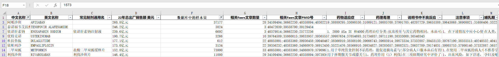
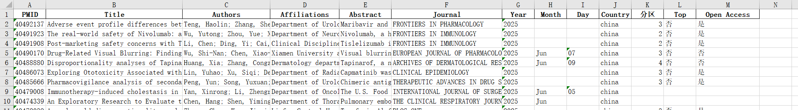
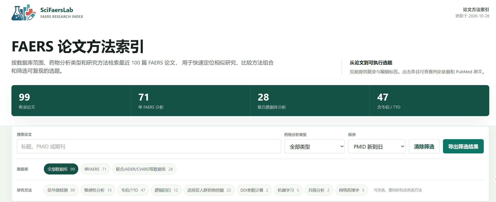

# 选题信息

**写 FAERS 文章之前，先查清楚这个方向还有没有可做的余地。**

选题信息每月更新，覆盖药物历史发表情况与 FAERS 文献情报，
帮助筛选尚未被大量研究过的药物、不良反应和研究组合。

## 所有药物的历史发表情况

提供约 9000 种药物（化学物质）的历史发表情况统计，
可用于快速判断一个研究方向是否已经过度饱和。

公开节选：[点击下载 9000 种药物发表情况节选](./信息资料/9000种药物(化学物质)发表情况节选.md)

## FAERS 文献信息

整理 NCBI 数据库中 FAERS 相关文章的基础信息，
可配合研究套路和论文方法索引判断现有研究的覆盖范围。

## FAERS 论文方法索引

FAERS 论文方法索引汇总了近期论文的数据库范围、药物分析类型和研究方法，
可以按多个条件组合筛选，用于快速定位相似研究、比较方法组合和判断选题方向。

- [进入 FAERS 论文方法索引](https://datapod.space/faers-paper/)
- [查看 Gitee 项目仓库](https://gitee.com/Twilight-of-sea/sci-faers-lab/blob/master/README.md)
- [查看 GitHub 项目仓库](https://github.com/TwilightOfSea/Sci-Faers-Lab-Clone)

方法标签为 AI 辅助整理，用于选题探索和方法比较，不构成系统综述。

## 怎么用它选题

1. 先查目标药物：同方向上已经发表过多少文章。
2. 再查目标不良反应：对应 PT、SOC 和相关研究是否密集。
3. 对照[研究套路](./文章套路.md)和[FAERS 论文方法索引](https://datapod.space/faers-paper/)，判断文章还能如何组合。
4. 优先选择仍有空间、但数据量足够支持分析的 drug-PT 组合。

## 获取方式

公开页面展示节选和示例；完整药物发表情况、FAERS 文献信息及月度更新，
随付费订阅服务在每月中旬通过邮箱推送。

